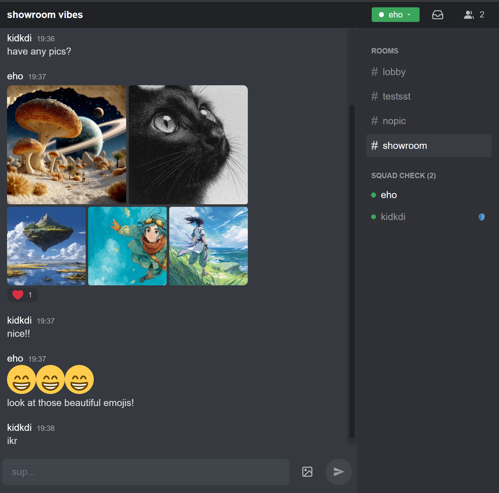

# Yap

Self hosted community chat inspired by Discord aesthetics

> **Branch `dmonly`:** this branch has no rooms. Every person talks to the admin and to nobody else; the admin
> sees a people page and opens a conversation from it. The design and the decisions are in
> [docs/dmonly.md](docs/dmonly.md). The branch builds its own image, `ghcr.io/urza/yap-dmonly`, with its own
> `latest`; the main image is untouched. The rest of this README describes the app that both builds share.




## Run with Docker

```bash
docker run -d --name yap -p 5221:8080 -v ./uploads:/app/wwwroot/uploads -v ./data:/app/Data ghcr.io/urza/yap-dmonly:latest
```

There are two volumes:
- "uploads" which holds media (pictures) uploaded by users
- "data" which contains configuration (appsettings.json), SQLite db (if enabled), and custom emojis

Access at `http://localhost:5221` - it's up to you how to make this accessible for others. For example use some reverse proxy like nginx proxy manager  (https://nginxproxymanager.com/) or cloudflare tunnel.

## Run from source

```bash
cd Yap && dotnet run
```

The addresses are in `Yap/Properties/launchSettings.json`. No database is needed; see `CONFIG_README.md` for the options.

The launch profiles do not open a browser (`launchBrowser: false`). Open the address yourself. When Visual
Studio starts the browser as part of an F5 session, it attaches its JavaScript debugger to it, and on one
Windows machine (Brave, 2026-10-15) that session ended at the first picture upload and took the server
with it, exit code -1. Start Without Debugging and `dotnet run` were never affected.

## Features

- **No registration required** - Just log in with username, no passwords or social logins
- **User profiles** - Set profile picture, display name, and bio; avatars shown in chat
- **Database optional** - Everything can be ephemeral and live only in memory (wiped on app reset) or you can use SQLite for persistence
- **Customizable labels in config** - make it fun or serious
- **Emoji support** - Beautiful Twemoji rendering 
- **Custom emojis** - Drop image files into `Data/custom-emojis/` (data volume) folder and they become available for your users
- **Gifs** - gifs by Klipy + your own, server collections curated by server admin, user favs + customs, bulk import / export
- **Themes** - Discord Dark, Midnight, Nord, Ocean, Sunset, Aurora, Terminal, Neon Glow, Tea House, Daylight, Solarized Light
- **Multiple rooms/channels** - admin can create new, nobody will come anyway
- **Direct messages** - Private conversations between users, not encrypted, treat accordingly
- **Message actions** - Discord-style hover popup with reactions, edit, delete
- **Reactions** - React to messages with emojis, even custom ones
- **Tab notifications** - Unread count in browser tab + audio notifications
- **Typing indicators** - See who's typing with customizable messages
- **Mobile responsive** - Works great(TM) on all devices with collapsible sidebar
- **PWA installable** - Add to home screen on mobile, install as app on desktop, get notifications
- **Image/Video sharing** - Upload image(s) or videos and see them in inline gallery
- **Social media previews/embeds** - Yap downloads that tiktok/youtube video so users dont need to go to these evil sites


## Under the hood

- The server is ASP.NET Core (.NET 10): a JSON API under `/api`, one SignalR hub at `/hub`, SQLite as an optional store. Without a database everything lives in memory until the next restart.
- The client is static files in `Yap/wwwroot`: plain HTML, CSS and JavaScript modules, no framework and no build step. The SignalR and tus browser clients are vendored in `wwwroot/lib`.
- Offline: a service worker keeps the shell, the emoji images and the media; the last messages and the unsent messages live in IndexedDB.
- The product spec is in `docs/spec`, the design in `docs/architecture`.
- Tests: `dotnet test Yap.Tests` for the server, and the Playwright scripts in `tests/browser` for the browser (node and npm are development tools only; see `tests/browser/README.md`).

## License

YOU CAN USE THIS SOFTWARE "AS IS" (NO WARRANTY) IN ANY WAY YOU WANT, BUT BY DOING SO YOU ACKNOWLEDGE THAT:

Science is a force for human liberation and one of humanity's greatest inventions. Through open inquiry, evidence, and the willingness to correct our errors, we expand our understanding and our ability to improve the human condition.

Technology is the physical manifestation of our discoveries. By building better tools, we overcome limitations, reduce suffering, and create abundance.

Free markets enable cooperation on an extraordinary scale. Through competition, exchange, and entrepreneurship, they reward useful ideas, spread innovation, and help lift people out of poverty.

