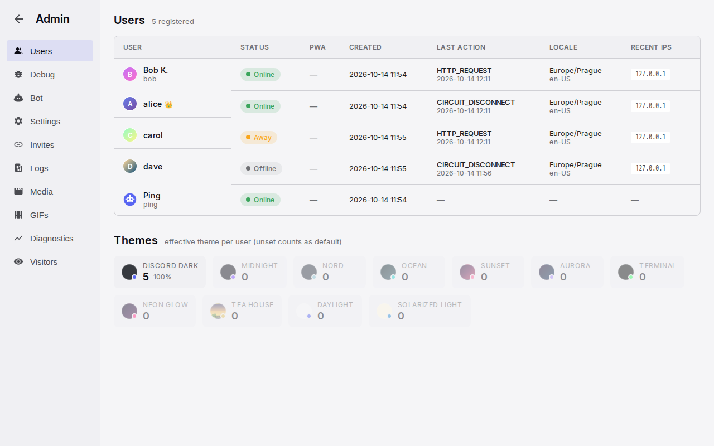

# Administration

Administration is the admin's page for the server: the people, the invites and login links, the registration switches, the bot, the server switches, the server's GIF library, the logs and the live diagnostics. There is one admin, the first account on the server. Rooms are created and changed on their own pages, reached from the sidebar; those pages are specified here too.

## Anatomy

1. **Navigation.** A 180 px column with a round back arrow, "Admin", and the tabs Users, Debug, Bot, Settings, Invites, Logs, Media, GIFs, Diagnostics, Visitors. On a phone, a horizontal tab bar under the back arrow.
2. **Content.** The open tab, with a title row (name and a count or subtitle), stat cards where the tab has them, filters, and tables that scroll sideways when wide.
3. **Tables.** Small capitals headers, 24 more rows per "Show more" tap, or 100 per "Load more" page.
4. **Room pages.** "Create Channel" and "Channel Settings", inside the chat frame, with the cards Channel Info, Permissions, History Visibility, Channel Order and Danger Zone.

## Rules

### Access and layout

**AD-01** Only the admin opens the page, from "Admin" in the status menu. Anyone else goes to the lobby. The page sits outside the chat frame, in the theme's colours. The back arrow goes to the lobby and is present on phones too.

**AD-02** Users opens first. Users, Bot, Invites and Settings load with the page; Logs, Media and Visitors load on first open; GIFs reloads on every open; Diagnostics refreshes every 30 seconds while open.

**AD-03** When the server runs without persistence, the page says so at the top, and Logs, Media and Visitors say that they need persistence instead of staying empty.

### Users

**AD-04** The Users table lists every account, the bot included, newest activity first: avatar, display name with the admin crown and the username, a status pill (Online, Away, Invisible, Offline; the admin sees Invisible as Invisible), whether the installed app was seen, the creation time, the last action, the time zone and language, and up to five recent network addresses. It is read when the tab opens and does not change until the next open.

**AD-05** A tap on a row opens its detail: notification devices, installed app, the effective theme, and tables of addresses with countries and of browsers, each with the last seen time.

**AD-06** There are no actions on an account: no disable, delete, rename, admin transfer or forced sign-out. The one rescue is a new login link from the Invites tab.

**AD-07** Under the table, Themes shows one card per theme with its count and share, most used first; unused themes are dimmed.

### Debug

**AD-08** The message generator posts test messages into a chosen room: a count (default 200) spread over a chosen span from an hour to a year, as real messages from the admin and five fictional people, in bursts. Generated messages add no unread counts.

### Bot

**AD-09** Bot Settings shows the bot's fixed username, its display name, and the welcome message with "{0}" for the server name. "Save" confirms with "Saved!". The welcome message is what the bot sends one minute after a person's first session, with the install line on phones and the login link.

### Settings tab

**AD-10** Registration has three switches that save at once: "Close registration", "Require approval" and "Smart login". Smart login is on by default. Their effects are on the [sign-in page](sessions.md#AU-05).

**AD-11** Pending Requests appears while someone waits: the username, how long ago, "Approve" and "Reject". It updates by itself when a request arrives. The admin also gets a message from the bot per request.

**AD-12** Link Previews has "Enable link previews" (on by default) and "Enable media caching" (off by default; disabled with a note when the downloader is missing). Both apply at once to every open chat.

**AD-13** GIFs has the provider's content rating: G, PG, PG-13 or R, PG by default, applied to the next search. The tab also shows whether a provider key is configured.

**AD-14** Deployment shows read-only how-to boxes for settings that need a matching DNS record: the upload subdomain and the IPv4 beacon, each with its current state.

### Invites and login links

**AD-15** The create form makes an invite for someone new, with a private note and an expiry (never, 1, 7 or 30 days), or a new login link for an existing person, which replaces their current link and sends them the bot's rescue message. No confirmation.

**AD-16** Open invites lists unclaimed invites with the link, a copy control, the note, created and expiry times, an expiry change and "Revoke". User login links lists every person's active or expired link with its status, the link where the admin may see it, "🔒 hidden" otherwise, who created it, how often it was used, and the same controls.

**AD-17** The admin sees a link's code only when the admin created it and it has not been used yet. Links people made for themselves are always hidden.

### Logs, Media, Visitors

**AD-18** Logs lists signed-in people's actions, newest first, with an action filter and a username filter: time, user, action, address, detail. 100 per page.

**AD-19** Media lists every upload with a preview, time, user, file name, type, size and processing time, with type and username filters, and stat cards for the converter's availability, total storage, images and videos.

**AD-20** Visitors lists anonymous visits and failed sign-ins with address, action, reason and browser, with stat cards for visits, failures, unique addresses and today. A tap on a row shows the full detail with the country.

### GIFs tab and the server library

**AD-21** The server library is a curated set every person sees as its own picker tab, searchable by everyone and ranked above the general pool. The admin manages it with the same library manager as My GIFs, without a quota: add files, import a zip, export, folders, tags, and "Delete", which removes the file for everyone, or "✕", which only takes a GIF out of the library.

**AD-22** Under it, a table of every GIF the server knows, custom uploads and provider cache alike, with a filter (all, custom, provider cache, favourited, server library): preview, date, source, uploader, format, dimensions, size, uses, favourites, tags, and the actions "★ server" to add to or remove from the library and "Delete", which asks "Sure?" first.

**AD-23** An admin delete removes the GIF from everyone's favourites. A GIF used in messages keeps its file so history still shows it; an unused one is removed with its files. The table confirms the result in a short line.

### Diagnostics

**AD-24** Stat cards show users, sessions, messages, connections, channels and subscribers from the latest 30-second sample.

**AD-25** The sessions table has one row per session, the bot left out: user, device and address, transport, connected, visible, status, the open conversation, last input, last report, age. A row that counts as visible while its connection is gone is drawn in the warning colour. Header tooltips explain each column.

**AD-26** The connections table shows latency per chat connection: transport, connected, round trip last, average and maximum, slow events, and send-to-appear last, average and maximum, with the last 50 closed connections greyed under it. Rows go to the warning colour on a fallback transport or an average round trip over 250 ms.

**AD-27** Push notifications shows whether the keys are configured and valid. The push audit lists the last 200 notification decisions (sent, or suppressed by a visible session) with the unread count, devices and sessions at that moment, and the last 200 results with sent, failed and total. The unread audit lists the last 200 direct-message count changes with their trigger and the device's state. All three live in memory since the last restart.

**AD-28** Three charts over the last seven days, one point per 30 seconds: users and sessions, connections active and disconnected, total messages. They use the theme's colours.

### Rooms

**AD-29** "Add Room" at the end of the sidebar opens Create Channel; the gear on a room row opens Channel Settings. Both are admin only and sit in the chat frame with a back arrow.

**AD-30** Channel Info has the name (lowercase, no spaces, at most 50 characters, unique) and the description (at most 500 characters, shown at the top of the room's history; empty means the default "This is the beginning of #{name}").

**AD-31** Permissions offers "Everyone" and "Admin Only". An admin-only room is visible to everyone and read-only for others.

**AD-32** History Visibility offers Unlimited, 1 Day, 3 Days, 1 Week, 2 Weeks, 1 Month, 3 Months, and "Only show messages since user joined". A new room starts with 1 Month and since-joined on. Admins always see everything.

**AD-33** Channel Order lists every room with "Move up" and "Move down"; a move saves at once and changes the sidebar order for everyone.

**AD-34** "Save Changes" is enabled once something changed and returns to the room; errors stay on the page. "Cancel" returns without saving. Create opens the new room, which goes to the bottom of the order.

**AD-35** Danger Zone, not shown for the lobby: "Delete Channel" arms on the first tap ("Click again to confirm") and deletes on the second, then goes to the lobby. Everyone's mute choices for the room are cleared, and open chats leave it at once.

### Outside the page

**AD-36** The project name, the playful text lists, branding files (icons, the installed app's name and colours) and the custom welcome page live in the server's configuration and data folders, not on this page. Text edits apply at the next render; branding files apply without a rebuild. Custom emoji are files in a server folder, read at startup.

## States

| State or trigger | Input | What the user sees |
| --- | --- | --- |
| Non-admin opens /admin | all | The lobby. |
| Row tap in Users | mouse, touch | Detail row with tags and tables; another tap closes it. |
| Generate | mouse, touch | "Generating..." then "Generated {n} messages spread across {h}h"; the room fills. |
| Bot Save | mouse, touch | "Saving..." then "Saved!". |
| Registration switch | mouse, touch | Saved at once; the login page changes for the next visitor. |
| Pending request arrives | all | The row appears; the bot's message arrives. |
| Approve or Reject | mouse, touch | The person's login page continues or shows the rejection. |
| Create link for a person | mouse, touch | "New link for {username} created. Their old one no longer works."; the person gets the bot's message. |
| Copy link | mouse, touch | "Copied!" for 2 s. |
| Revoke | mouse, touch | The row disappears; devices stay signed in. |
| ★ server | mouse, touch | The GIF joins or leaves the server library at once. |
| Delete in the GIFs table | mouse, touch | "Sure?", then removed with a result line. |
| Diagnostics open | all | Tables and charts refresh every 30 s; expanded tables stay expanded. |
| Ghost session | all | Row in the warning colour. |
| Create Channel with a name | keyboard, mouse | "Create Channel" enabled; the new room opens at the bottom of the list. |
| Duplicate name | keyboard, mouse | "A channel with that name already exists." |
| Move up or down | mouse, touch | Order changes at once for everyone. |
| Delete Channel | mouse, touch | "Click again to confirm", then the lobby. |
| Phone | touch | Horizontal tab bar; wide tables scroll sideways. |

## Wording

| Where | Text |
| --- | --- |
| Navigation | "Admin"; "Go back"; "Users"; "Debug"; "Bot"; "Settings"; "Invites"; "Logs"; "Media"; "GIFs"; "Diagnostics"; "Visitors" |
| Users | "Users"; "{n} registered"; columns "User", "Status", "PWA", "Created", "Last Action", "Locale", "Recent IPs"; pills "Online", "Away", "Invisible", "Offline"; "Installed"; "Push {n} sub(s)"; "No push"; "PWA installed ({date})"; "No PWA"; "{theme} (default)"; "IP Addresses"; "User Agents"; "Themes"; "effective theme per user (unset counts as default)" |
| Debug | "Message Generator"; "Generate test messages for debugging"; "Channel"; "Number of messages"; "Spread across"; "Last 1 hour" … "Last 1 year"; "Generate {n} messages"; "Generating..."; "Generated {n} messages spread across {h}h"; "Error: {message}" |
| Bot | "Bot Settings"; "System bot configuration"; "Username"; "Username cannot be changed after creation"; "Display Name"; "Welcome Message"; "Sent to new users as a DM. Use {0} for the server name. Mobile users also get a PWA install link and their login link."; "Save"; "Saving..."; "Saved!" |
| Registration | "Registration"; "Control who can join"; "Close registration"; "Block all new signups. Login page shows \"temporarily closed\"."; "Require approval"; "New users must wait for admin approval before joining."; "Smart login"; "Auto-login returning users from the same IP address without secret code."; "Pending Requests"; "{n} waiting"; "Approve"; "Reject" |
| Link previews | "Link Previews"; "OpenGraph preview cards"; "Enable link previews"; "Show OpenGraph preview cards below messages with URLs."; "Enable media caching"; "Auto-download videos/audio from YouTube, Spotify, SoundCloud (under 10 min) for inline playback."; "yt-dlp not found on this system." |
| GIF rating | "GIFs"; "Klipy content rating"; "Content rating"; "How strictly Klipy filters search and trending results. G = strictest (kid-friendly). PG = mild (default). PG-13 = some edgy content. R = anything goes." |
| Deployment | "Deployment"; "Set in appsettings.json, per instance"; "Upload subdomain (tus)"; "IPv4 beacon" |
| Invites | "Invite & Login Links"; "{n} open · {m} active"; "For"; "Someone new (invite)"; "Note"; "for Tom"; "Expires"; "Never"; "In 1 day"; "In 7 days"; "In 30 days"; "Create link"; "Invite created"; "New link for {username} created. Their old one no longer works."; "An invite lets whoever opens it pick a username and join, even while registration is closed. A link for an existing user replaces their current one (the rescue for someone locked out of every device); they get a bot DM about it. Codes stay readable here only until the link is first used."; "Open invites"; "No open invites."; "Copy link"; "Copied!"; "Change expiry"; "Revoke"; "User login links"; "No user links yet."; "Active"; "Expired"; "🔒 hidden"; "Only the user can see this code"; " by admin"; "{n}× · {time} ago" |
| Logs | "Action Logs"; "{n} loaded"; "All actions"; "Filter by username..."; "Load more"; "No log entries found." |
| Media | "Media"; "{n} files"; "FFmpeg"; "Available"; "Unavailable"; "Total Storage"; "Images"; "Videos"; "No media uploads found." |
| GIFs | "{shown} of {total} entries"; "Custom GIFs"; "Provider Cache"; "Server library"; "A curated GIF set every user sees: its own picker tab, searchable by everyone, ranked above the general pool. Import files or a zip, organize with folders. Promote existing entries from the table below."; "All entries"; "Custom uploads"; "Provider cache"; "⭐ Favorited"; "☆ server"; "★ server"; "Add to server library"; "Remove from server library"; "Delete this GIF everywhere"; "Sure?"; "No GIFs in the library yet."; "No GIFs match this filter."; "The server library is empty — add GIFs above to give everyone a curated set." |
| Diagnostics | "Diagnostics"; "Live system metrics"; "Sessions — presence truth table"; "No active sessions."; "Connections — latency"; "RTT last/avg/max"; "Slow events"; "Send→appear last/avg/max"; "Recently closed"; "Push notifications"; "✅ Configured — VAPID keypair verified at startup."; "❌ DISABLED — VAPID keypair is invalid."; "⚠️ Not configured — no VAPID keys set."; "Push audit — decisions & results"; "No push activity since restart."; "push"; "suppressed: Online + visible"; "Unread audit — DM badge changes"; "No DM unread activity since restart."; "Users & Sessions"; "Connections: Active vs Disconnected"; "Messages" |
| Visitors | "Visitors"; "{n} visits tracked"; "Total Visits"; "Login Failures"; "Unique IPs"; "Today"; "All"; "Visits only"; "Login failures only"; "No visitor data yet. Visitors are tracked when they load the login page."; "Wrong passphrase"; "Registration closed"; "Bot username"; "IP mismatch"; "Approval pending" |
| Room pages | "New Channel"; "#{name} Settings"; "Channel Settings"; "Create Channel"; "Channel Info"; "Name"; "channel-name"; "Lowercase, no spaces."; "Description"; "Shown at the top of the channel. Leave blank for the default \"This is the beginning of #channel\" message."; "{n}/500"; "Permissions"; "Who can send messages in this channel"; "Everyone"; "All users can send messages"; "Admin Only"; "Only admin can send messages (read-only for others)"; "History Visibility"; "How far back non-admin users can scroll through message history"; "Unlimited"; "1 Day"; "3 Days"; "1 Week"; "2 Weeks"; "1 Month"; "3 Months"; "Only show messages since user joined"; "Each user only sees messages posted after they signed up. When combined with a time limit, the more restrictive cutoff applies. Admin always sees full history."; "Channel Order"; "Use the arrows to reorder channels in the sidebar"; "Move up"; "Move down"; "Cancel"; "Save Changes"; "Saving..."; "Creating..."; "Danger Zone"; "Delete this channel"; "This action cannot be undone. All messages will be lost."; "Delete Channel"; "Click again to confirm"; "Channel name is required."; "A channel with that name already exists."; "Failed to delete channel." |

## Related

- [Sign-in and sessions](sessions.md) for registration, invites, links and the bot's messages.
- [Header, sidebar and overlays](frame.md) for the sidebar's rooms, Add Room and the gear.
- [Timeline and media](timeline.md) for history visibility as people see it.
- [Emoji and GIF pickers](pickers.md) for the server library in the picker.
- [Notifications and unread](notifications.md) for what the push and unread audits record.
- [Presence](presence.md) for the sessions table's columns.
