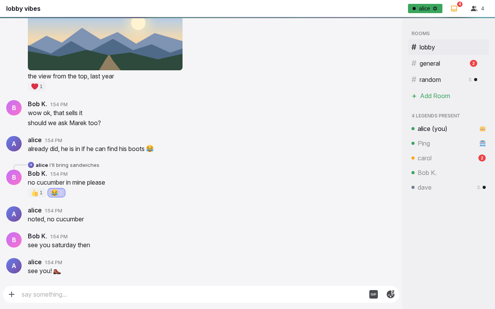
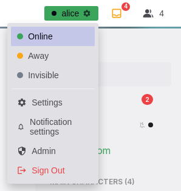
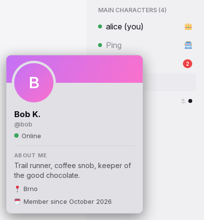
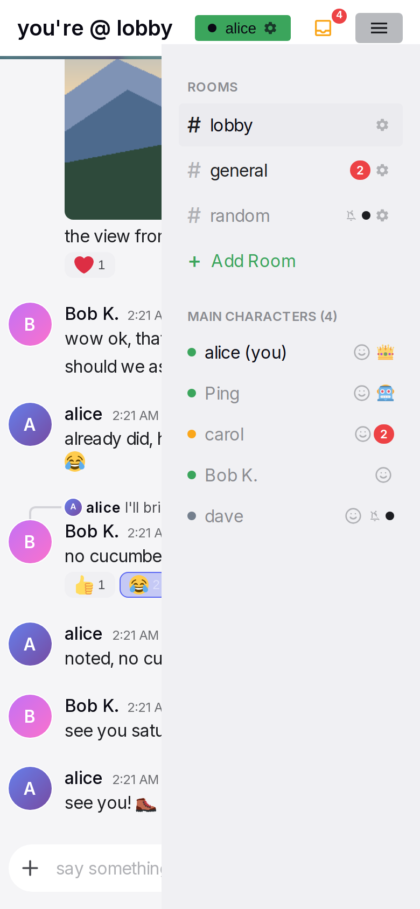

# Header, sidebar and overlays

The frame contains all parts around a conversation. The header shows the title, the user's status chip and the people control. The sidebar shows the rooms and the people. Other parts appear over the page: the status menu, the profile card, the connection state, the notice strip, the install and notification prompts, and the error screen. The frame is the same on every conversation page and on Settings.

## Anatomy

1. **Header.** One row with the title area on the left. On the right are the status chip, the pin button when the conversation has pinned messages, the mailbox when there are unread messages, and the people button with the online count. Below the header is a 3 px line, turquoise in rooms and purple in direct messages.
2. **Title area.** In a room, a title from the configured list, built from the room name. In a direct message, a back arrow and the partner's small avatar and name. On Settings, a back arrow and "Settings".
3. **Status chip.** A small coloured chip with a dot, the user's display name and a gear. Its colour shows the user's current status. It opens the status menu.
4. **Mailbox.** A tray icon with a red count of unread messages. It shows only when the count is above zero.
5. **People button.** On desktop, a people icon with the online count. On narrow screens, a hamburger that opens the sidebar.
6. **Connection dot.** A small dot at the left of the header controls, before the status chip. It shows only while the connection is not normal.
7. **Sidebar.** A panel on the right, 240 px wide on desktop. It contains the section "ROOMS" with every room, then the people section. The people section has a title from the configured list and the online count.
8. **Notice strip.** A one-line strip between the header line and the conversation. It shows only for a lasting state that needs an action from the user: a new version, or a sign-in.
9. **Overlays.** The status menu, the pinned messages panel, the profile card, the notification prompt, the install dialog and the error screen.

## Rules

### Layout

**SH-01** The chat screen fills the window. The screen as a whole never scrolls. The header is at the top, with the header line below it. Below the line, the conversation is on the left and the sidebar is on the right.

**SH-02** Above 768 px, the sidebar is always visible and 240 px wide. At 768 px or less, the sidebar slides in from the right over the conversation. The header then shows a hamburger in place of the people count.

**SH-03** The frame uses a 768 px width tier and the compact components use a 600 px tier. The two tiers are intentionally different. A window between 601 and 768 px has the slide-in sidebar with desktop components.

**SH-04** The theme's background pattern shows only behind the messages. It never shows behind the header or the sidebar. A room and a direct message can have a different pattern and tint. Status colours never change with the theme context.

### Header

**SH-05** In a room, the title is one text from the configured room header list, with the room name inserted. The text is picked when the conversation opens. It stays until the user leaves the conversation. The fallback is "# {room}".

**SH-06** In a direct message, the title area shows a back arrow, the partner's 24 px avatar and the partner's display name. When the partner has no display name, it shows the username. The back arrow goes to the lobby at every width.

**SH-07** On Settings, the title area shows a back arrow and "Settings". Channel settings show "#{room} Settings". A new channel shows "New Channel".

**SH-08** The people button shows the number of people online. Invisible people are not counted. At 768 px or less, the count is hidden and the button is a hamburger that opens the sidebar.

**SH-09** The mailbox is a tray icon with a red count. It shows only while the total unread count is above zero. Its tooltip is "{n} unread messages". The total is the sum of the counts in the sidebar, and does not include the open conversation. On narrow screens, a tap on the mailbox opens the sidebar. See [Notifications and unread](notifications.md).

**SH-10** At 600 px or less, the header has more padding, a larger title and a shorter chip name.

### Status chip and menu

**SH-11** The chip shows a dot, the user's display name and a gear. Its colour shows the user's current status. The colour is green for online, orange for away and grey for invisible. An automatic away changes the colour. It does not change the chosen status.

**SH-12** A tap on the chip opens the menu below the chip. The menu items are "Online", "Away", "Invisible", a divider, "Settings", "Notification settings", "Admin" for admins, and "Sign Out" in red. The chosen status is highlighted. A second tap on the chip, a tap outside the menu, or Escape closes the menu. Settings opens the Settings page. Notification settings opens the notification section of that page. Admin opens the administration page, which has its own back arrow.

**SH-13** A status pick applies immediately and closes the menu. Without a connection, the three status items are dimmed and do nothing. See [Presence](presence.md).

**SH-14** "Notification settings" shows a crossed bell while the user's server-wide mute is on. This makes the mute visible from every page.

**SH-15** Sign Out ends only the session on this device. Other devices stay signed in. When the user has no login link, no secret code and no passkey, a confirmation warns that the user cannot get back into the account. When this device has unsent messages, a confirmation warns that these messages are lost. A sign-out removes the notification subscription and the local data of the device. See [Sign-in and sessions](sessions.md).

### Connection state

**SH-16** While the connection is normal, the header shows no connection indicator.

**SH-17** While Yap connects or reconnects, a pulsing orange dot shows before the status chip. The header line also pulses orange. Without a connection, the dot is a grey ring and the header line is dimmed. When the user must do an action, the dot is red and the notice strip tells the user what to do. With reduced motion, there is no pulse. The chip, the count and the people list keep their last known state until the connection returns.

**SH-18** On hover or after a tap, a short text bubble shows the meaning of the dot. The texts are "Connecting…", "Reconnecting…", "Offline. Messages are sent when the connection returns.", "Signed out", "Update available". While Yap is disconnected, a tap on the dot also starts a reconnect. The next tap elsewhere closes the bubble.

**SH-19** During an outage, the conversation stays readable and usable. There is no banner over the page and no modal.

**SH-20** The notice strip shows only for two lasting states. For a new version, it shows "You are awesome and so is the new version of this app. Please refresh." with a "Reload" button. Yap never reloads by itself. When the user is signed out and there is no connection, it shows "Sign in to continue." with a "Sign in" link. When there is a connection, the user goes to the login page instead. The strip has one line and at most one control. While the strip shows, the conversation is shorter.

### Sidebar: rooms

**SH-21** The sidebar has two sections in this order: "ROOMS", then the people section. Section titles are in small capitals.

**SH-22** Every user sees every room, in the order that the admin sets. New rooms are added at the bottom. A room row shows "#" and the name. Next, it shows a crossed bell when the user muted that room individually. The bell does not show for the default room mute or under the server-wide mute. Then the row shows an unread mark and, for admins, a gear. The open room is highlighted and shows no unread mark.

**SH-23** For an unmuted room, the unread mark is a red count. For a muted room, it is a small dot without a number. A mute hides the number. The dot still shows that something arrived. An unmuted room with unread messages has brighter text.

**SH-24** The gear opens the room's settings. On desktop, the gear appears on hover. On touch screens, it is always visible. Admins also see "Add Room" as the last row.

**SH-25** An admin-only room is visible to everyone and read-only for non-admins. The lobby cannot be deleted. When a room is created, renamed or deleted elsewhere, the list updates immediately. When the open room is deleted, the user goes to the lobby.

**SH-26** A tap on a room opens it and closes the sidebar on narrow screens.

**SH-27** The sidebar scrolls as one area when its content is taller than the screen. A short list shows no scrollbar. On a narrow screen a fade at the bottom edge shows while rows are hidden below it.

### Sidebar: people

**SH-28** The title of the people section is one text from the configured list, with the online count inserted. The fallback is "Online Users ({n})". A new text is picked when the count changes.

**SH-29** The list contains every person who is online or away. It also contains every person with whom the user exchanged at least one direct message. An invisible person shows only as a direct message partner. That person is grey, the same as an offline person, and is not counted.

**SH-30** The order is admins, then the bot, then the user, then everyone else. The bot slot and the user slot are used only when that person is not already placed as an admin. Everyone else is in this order: unmuted direct messages with unread first, then people online, then offline people with the most recent direct message first. Within a tier, people with the same rank are in order of display name.

**SH-31** A row shows a status dot, which is green for online, orange for away and grey otherwise. It also shows the display name, " (you)" on the user's own row, and the info button where SH-34 shows one. Other icons are a crown for admins, a robot for the bot and a crossed bell for a muted direct message. The row also shows the unread mark, with the room rules. Rows show no avatar and no message preview.

**SH-32** A tap on another person opens the direct message with them and closes the sidebar on narrow screens. A tap on the user's own row, outside the info button, does nothing. The open direct message's row is highlighted.

**SH-33** The list, its dots, its title and its counts update immediately when a person joins, leaves or changes status, or when an unread count changes.

### Profile card

**SH-34** Above 768 px, when the pointer is on a person's name, the profile card of that person shows next to the pointer. The card closes when the pointer leaves the name. On any touch screen, and at 768 px or less, an info button after the name opens the card. The card is centred over a dimmed page. A second tap on the button, a tap outside, Escape, or a room or person pick closes the card. A tap on the row outside the button opens the direct message. The user's own row opens the user's own card. The card shows the status at the time it opened.

**SH-35** The card shows a banner in the person's avatar colours, the 80 px avatar, and the display name with the admin crown or the bot badge. It then shows "@username" and a status line "Online", "Away" or "Offline". An invisible person shows as offline. The card then shows "About me" with the bio or "No bio yet — a person of mystery 🕵️", "📍 {location}" when set, and "🗓️ Member since {Month yyyy}". It has no buttons.

### Sidebar on phones

**SH-36** The hamburger or the mailbox opens the sidebar. The sidebar slides in from the right, with its top edge below the header. The conversation stays visible and is not dimmed. The header stays usable.

**SH-37** The sidebar closes on a tap outside it, on a room or person pick, on the hamburger, and on any menu item that goes to another page.

### Prompts and dialogs

**SH-38** The notification prompt appears on a chat page when four conditions are all true. Yap runs as an installed app. The browser was not asked yet. The user dismissed the prompt fewer than three times on this device. The server can send notifications. The prompt is a centred card over a dark layer. It shows a bell, "One more step", the explanation, "Enable Notifications" and "Maybe Later". See [Notifications and unread](notifications.md).

**SH-39** "Enable Notifications" asks the browser and then closes the prompt, whatever the answer is. "Maybe Later" counts one dismissal. After three dismissals, the prompt never shows again on this device.

**SH-40** The "install it" link in the bot's welcome message and "Install Yap" in Settings open the install dialog. The dialog shows "Add Yap to your home screen" with the buttons "Use existing app" and "Install app". When Yap is installed, it shows "Yap is already installed" with "Close". "Install app" starts the browser's install or shows the add-to-home-screen guide. See [Offline and installation](offline.md).

**SH-41** When a page fails, the conversation area shows "Something went wrong" with "Try Again" and "Reload Page". The header and the sidebar stay. Try Again draws the page again. Reload Page reloads the page. Drafts and unsent messages are kept after both actions. When Yap cannot start at all, the gremlin screen shows "Oops! The gremlins got us" with "Reload & Try Again".

### Routes and the tab

**SH-42** The routes are /lobby for the default room, /room/{id}, /dm/{username}, /settings, /admin, /channel/new, /channel/{id}/settings, /login, /verify/{username}, /invite/{code}, and / for the start. When the user is signed in, a room or direct message link opens directly. When the user is signed out, the login page opens, and the link opens after the sign-in. An unknown address shows "Not Found".

**SH-43** / opens the user's last conversation on this device. If there is none, / opens the lobby. /dm/{unknown user}, /dm/{the user themself} and /room/{unknown id} go to the lobby.

**SH-44** Browser back goes to the previous conversation or page. The header back arrow always goes to the lobby.

**SH-45** The tab title is "{Project} | #{room}" in a room and "{Project} | @{username}" in a direct message. On the Settings and Admin pages, it is "Settings" and "Admin". While the tab is hidden, a "({n}) " prefix counts the arrivals by the rules on the [notifications page](notifications.md). The prefix resets when the user returns.

**SH-46** The installed app's icon shows the unread total as a badge where the system supports it. Yap does not ask for permission for the badge. The badge clears when the total is zero.

### Pinned messages

**SH-47** A pin icon with the count of pins shows in the header controls, before the mailbox, when the open conversation has pinned messages. It is absent when there are none and on the Settings and Admin pages. A tap opens the pinned messages panel. A second tap closes it. The [message row page](message-row.md#MR-77) specifies who can pin.

**SH-48** The panel has the title "Pinned Messages" and a close control. On desktop, it is a panel below the button, at most 70 % of the window height, with its own scroll. On a phone, it is a sheet from the bottom over a dimmed page. It has one entry per pin, the newest pin first, at most three. An entry shows the author's avatar, display name and time, the whole text, the first image or the video poster when there is one, "GIF attachment" for a GIF without text, and "Pinned by {name}". For readers who may pin, an entry has an "✕" control that unpins the message. The panel follows changes while it is open: an edit of a pinned message changes its text, a delete or an unpin removes its entry, and a new pin adds an entry. It closes when the last pin goes. In a room with a history limit (TL-05), a reader sees only the pins of messages inside their own history. The pins stay through a restart of the server, also when the pinned message is older than the history the server keeps in memory. Escape, the close control and a tap outside close the panel.

**SH-49** A tap on an entry scrolls the list to the message and highlights it, like a tap on a reply quote. Older messages load on the way when the row is not loaded yet. The panel closes when the row is on screen. When the message is older than the history that the reader can load, the panel stays and the entry shows "Not in the loaded history" for two seconds.

## States

| State or trigger | Input | What the user sees |
| --- | --- | --- |
| Room opened | all | Room title from the configured list, turquoise line, room row highlighted. |
| Direct message opened | all | Back arrow, avatar and name, purple line, person's row highlighted. |
| Unread arrives elsewhere | all | Red count or dot on its row; the mailbox total increases unless the conversation is muted. |
| Open conversation | all | Its row shows no count; the total does not include it. |
| Chip tap | mouse, touch | Status menu below the chip. |
| Status pick | mouse, touch | Chip colour changes immediately; menu closes. |
| Automatic away | all | Chip changes to orange; the menu still marks Online. |
| Tap outside the menu, Escape | mouse, touch, keyboard | Menu closes. |
| Connection lost | all | Grey ring, dimmed header line; page stays usable. |
| Reconnecting | all | Pulsing orange dot and line. |
| Connected | all | No indicator. |
| Dot hover or tap | mouse, touch | Text bubble with the state. |
| New version | all | Orange notice strip with "Reload". |
| Signed out elsewhere, connected | all | The login page at the next action. |
| Signed out elsewhere, no connection | all | Red dot; strip "Sign in to continue." |
| Hover a name, desktop | mouse | Profile card next to the pointer. |
| Info button, touch or narrow | touch, mouse | Centred card over a dim layer. |
| Hamburger or mailbox, narrow | touch, mouse | Sidebar slides in; header still usable. |
| Tap outside the sidebar | touch, mouse | Sidebar closes. |
| Room or person pick, narrow | touch, mouse | Conversation opens; sidebar closes. |
| Gear on a room | mouse, touch | Room settings. The gear is always visible on touch. |
| Sign Out without a way back | mouse, touch | Confirmation that the account becomes unreachable. |
| Sign Out with unsent messages | mouse, touch | Confirmation that these messages are lost. |
| Installed app, permission not asked | all | "One more step" prompt, up to three times. |
| Page error | all | "Something went wrong", "Try Again", "Reload Page". |
| Tab hidden, arrivals | all | "({n}) " before the title. |
| Pin button tap | mouse, touch, keyboard | The pinned messages panel opens; a second tap closes it. |
| Pinned entry tap | mouse, touch, keyboard | The list scrolls to the message and highlights it, and the panel closes; or "Not in the loaded history" at the entry. |
| Pinned entry ✕ | mouse, touch | The entry goes for every reader; the last one closes the panel and hides the button. |

## Wording

| Where | Text |
| --- | --- |
| Room header list (configured; defaults) | "# {0}", "you're @ {0}", "{0} chat", "welcome to {0}", "{0} vibes" |
| Room header fallback | "# {0}" |
| People section titles (configured; defaults) | "the gang ({0})", "squad check ({0})", "main characters ({0})", "{0} legends present", "chat fam ({0})" |
| People section fallback | "Online Users ({0})" |
| Header titles | "Settings"; "#{room} Settings"; "New Channel" |
| Header tooltips | "Back to lobby"; "Toggle sidebar"; "{n} unread messages"; "{n} pinned messages" and "1 pinned message" |
| Pinned messages panel | "Pinned Messages"; "Pinned by {name}"; "GIF attachment"; image alt "Attachment"; "✕" (titles "Close" and "Unpin"); "Not in the loaded history" |
| Status menu | "Online"; "Away"; "Invisible"; "Settings"; "Notification settings"; "Admin"; "Sign Out" |
| Sign-out confirmations | "You have no login link or passkey. Without one, you won't be able to get back into this account. Continue signing out?"; "Unsent messages on this device will be lost. Continue signing out?" |
| Connection bubble | "Connecting…"; "Reconnecting…"; "Offline. Messages are sent when the connection returns."; "Signed out"; "Update available" |
| Notice strip | "You are awesome and so is the new version of this app. Please refresh." with "Reload"; "Sign in to continue." with "Sign in" |
| Sidebar | "ROOMS"; "Add Room"; " (you)"; tooltips "Channel settings", "Notifications muted", "Admin", "Bot", "View profile" |
| Profile card | "@{username}"; "Online"; "Away"; "Offline"; "About me"; "No bio yet — a person of mystery 🕵️"; "📍 {location}"; "🗓️ Member since {Month yyyy}" |
| Notification prompt | "One more step"; "Please enable notifications so Yap can send you notifs about new DM messages / mentions when the app is not open. You can always change this later in Settings, and you can also disable notifications temporarily."; "Enable Notifications"; "Enabling..."; "Maybe Later" |
| Install dialog | "Add Yap to your home screen"; "Already have a Yap icon? Open it to keep using your app. To replace an older install, save your login link in Settings, remove the old icon, then install here."; "Use existing app"; "Install app"; "Yap is already installed"; "Keep using this app. You do not need to install it again."; "Close" |
| Error screen | "Something went wrong"; "Try Again"; "Reload Page" |
| Start failure | "Oops! The gremlins got us"; "Something went terribly wrong. Our best engineers (who are also gremlins) are looking into it."; "Reload & Try Again"; "If this keeps happening, try clearing your browser cache or yelling at your computer." |
| Not found | "Not Found"; "Sorry, the content you are looking for does not exist." |
| Tab titles | "{Project} \| #{room}"; "{Project} \| @{username}"; "({n}) " prefix; "Settings"; "Admin"; "#{room} Settings"; "New Channel" |

## Related

- [Presence](presence.md) for who counts as online and the status rules.
- [Notifications and unread](notifications.md) for the counts, the mutes, the title prefix and the notification prompt's effect.
- [Sign-in and sessions](sessions.md) for sign-out, login links and sessions on other devices.
- [Offline and installation](offline.md) for the install flow and what works without a connection.
- [Settings](settings.md) and [Administration](admin.md) for the pages the menu opens.
- [Timeline and media](timeline.md) for the conversation under the frame.
