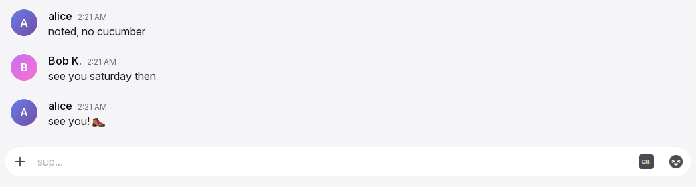
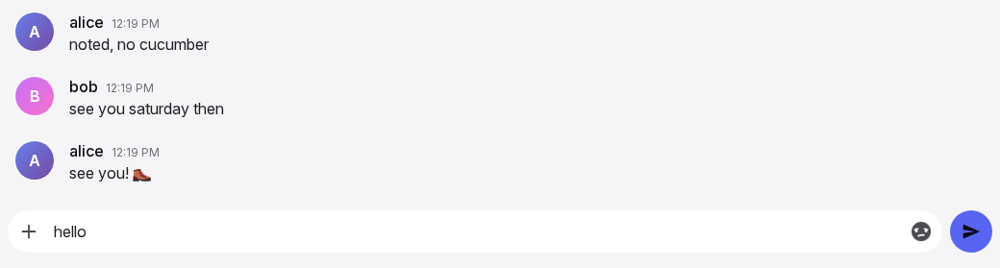
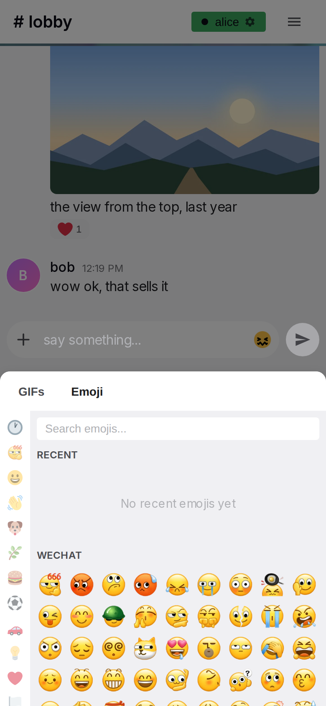

# Input box

The input box is the part of a conversation where the user writes and sends a message. It is at the bottom of every conversation, room or direct message. It accepts text, emoji, GIFs, images and videos. It shows who is typing in the conversation and which message the user replies to. Each action in the box takes effect immediately. No action in the box waits for the server.

## Anatomy

1. **Typing strip.** An 18 px band above the box that shows who is typing in this conversation. When nobody types, the strip is empty and keeps its height, so the box does not move.
2. **Reply bar.** A bar with "Replying to" and the name on the left, and ✕ on the right. It shows only while the user writes a reply. It is directly above the pill and makes one block with it.
3. **The pill.** A rounded field with 22 px corners, in the theme's input colour. It contains +, the text area and the two toggles, and the tray above them while files wait. The band around the pill is transparent, so only the pill has colour.
4. **+ (attach).** A button on the left side in the pill. It opens the file chooser. The chosen files go to the tray.
5. **Tray.** A line of square thumbnails above +, inside the pill, for the files that wait for Send. Each thumbnail has ✕ in its corner. The tray shows only while it has a file.
6. **Text area.** The field for the draft text. It starts as one line, grows with the text up to 200 px, then scrolls.
7. **GIF toggle.** A small badge with the text "GIF", on desktop only. It collapses while the draft has text.
8. **Emoji toggle.** A button with a grey silhouette of a random emoji. It changes to full colour on hover and while its picker is open.
9. **Send.** A button with a paper plane icon, outside the pill on its right side. It is hidden while the draft and the tray are empty and no picker is open.
10. **Read-only bar.** A bar that replaces parts 2 to 9 in a room where the user has no permission to write.
11. **Pickers.** The emoji picker and the GIF picker. They open from the toggles, above them on desktop and as one bottom sheet on a phone. The [pickers page](pickers.md) specifies their content.

## Rules

### Layout and look

**IB-01** The input box is the last block of the conversation column, under the message list, on every conversation page.

**IB-02** The pill has 22 px corners and the theme's input colour. The band around the pill stays transparent. *Why:* a coloured band takes attention from the message list. One theme had a coloured band, and it was removed.

**IB-03** The pill contains these items, from left to right: +, the text area, the GIF toggle, the emoji toggle. While files wait, the tray is a line above them, across the pill (IB-33). Send is outside the pill, with an 8 px gap. All items align to the bottom edge, so the buttons stay in place when the text grows.

**IB-04** The text area starts as one line and is at least 44 px high. It grows with its content up to 200 px, then scrolls without a visible scrollbar. A word that is too long for one line wraps to the next line inside the box.

**IB-05** After a send, the text area immediately returns to one line.

**IB-06** On desktop, the +, GIF, emoji and Send buttons are 44 px circles. On a phone, they are 40 px.

**IB-07** On a phone, the draft text is always 16 px. The user's text size setting does not change it. On desktop, the draft text uses the text size setting. *Why:* iOS zooms the page when a field with smaller text gets focus.

**IB-08** The phone layout applies when the window is 600 px wide or less. Only the window width selects the layout. The device type has no effect.

**IB-09** While the reply bar is visible, the top corners of the pill are square. The bar is directly above the pill with no gap, so the bar and the pill look like one block.

### Typing text

**IB-10** Keystrokes, deletions and pastes change the box immediately. No action in the box waits for the server. See [General rules](general-rules.md).

**IB-11** On a device without touch input, Enter sends the message and Shift+Enter inserts a newline. Enter does nothing when the draft is empty or contains only whitespace.

**IB-12** On a device with touch input, Enter inserts a newline. Only the Send button sends the message.

**IB-13** While an input method editor composes a character (for example, Japanese or Chinese input), Enter goes to the editor. Enter does not send the message.

**IB-14** A message contains at most 4000 characters. The box does not accept more characters. When a paste goes over the limit, the box cuts the pasted text at the limit.

**IB-15** A paste of text works as a normal paste. A paste of images or videos puts them in the tray (see IB-29 to IB-37). In that case, no text from the clipboard is pasted. The box ignores pasted files of other kinds.

**IB-16** In a direct message, the placeholder is "Message @{username}". In a room, the placeholder is one random text from the configured list. The box selects it when the conversation opens. The text does not change until the user leaves the conversation. The placeholder is never empty.

**IB-17** Escape closes the topmost open layer: a dialog if one is open, otherwise a picker. Escape never clears the draft and never cancels a reply.

### Send

**IB-18** Send is hidden while the draft is empty, the tray is empty and no picker is open. It collapses in 0.15 s, and the pill becomes wider to fill its space. "Empty" means that the draft has no characters. A single space makes the button visible.

**IB-19** When the draft has text, Send has the accent colour and a white icon. A theme can add a soft glow to Send. No other control in the chat has a glow.

**IB-20** When a picker is open, the draft is empty and the tray is empty, Send is visible and dimmed. *Why:* the user sees that Send is the next step after a pick.

**IB-21** Send is never disabled. When the draft contains only whitespace and the tray is empty, a tap on Send sends nothing and does not change the draft.

**IB-22** A tap or click on Send never moves focus. An open phone keyboard stays open, and a closed phone keyboard stays closed. *Why:* a focus move at this point closes the picker during the tap, and it opens the keyboard after every send.

**IB-23** On a phone, when the user picks emoji with the sheet open, the first tap on Send sends the message.

**IB-24** A send takes effect immediately, before the server answers. The draft is cleared. The text area shrinks to one line. An open picker closes. A pending copy of the message appears at the end of the list, and the list scrolls to it. Text that the user types immediately after a send goes into the empty box.

**IB-25** The pending message is a full message row, faded, at the end of the list. It becomes a normal row when the server accepts it. The [message row page](message-row.md) specifies how it looks.

**IB-26** When a message cannot be sent, its row shows as failed, with the reason, Retry and Remove. Remove deletes the message from this device only.

**IB-27** A send while the reply bar is open sends a reply. The bar closes immediately.

**IB-28** Messages sent quickly one after another appear in the order they were sent.

### Attachments

**IB-29** + opens the system file chooser for images and videos. The user can choose several files in one selection. On a phone, the chooser offers the camera and the photo library. The chosen files go to the tray (IB-33). + stays visible while the user types.

**IB-30** Files dropped on the input box go to the tray in the same way. While the user drags a file (not text) over the box, the box shows "Drop images here" and an accent ring. The ring disappears on a drop, when the drag leaves the box, and when the drag is cancelled. A drop anywhere else does nothing, and the browser does not open the file.

**IB-31** The accepted types are images (.jpg, .jpeg, .png, .gif, .webp) and videos (.mp4, .webm, .mov, .avi, .mkv). The box ignores dropped or pasted files of other kinds. When the user chooses a file of another kind with +, the dialog of IB-35 lists it as unsupported, and the file does not go to the tray.

**IB-32** The maximum size of one file is the configured size limit. The default limit is 100 MB. One message contains at most 10 files. A pick that takes the tray over 10 files is refused, and no file of that pick goes to the tray. The refusal text is "Choose at most 10 files."

**IB-33** Chosen, dropped and pasted files wait in a tray inside the input box, above the draft. Each file shows as a square thumbnail, 72 px on desktop and 64 px on a phone, with ✕ in its top right corner. A video shows its first frame and a play mark. ✕ removes the file from the tray. On a phone, the tray scrolls sideways. Send sends the files of the tray and the draft text together, as one message. The text is the caption of the message (MR-24). Send is visible while the tray has a file, and on desktop Enter sends with an empty draft. Nothing is uploaded before Send. Each conversation has its own tray. The tray does not survive a reload. A GIF file becomes a GIF attachment, the same as a GIF sent from the picker.

**IB-34** While files upload, the pending row shows the caption when there is one, the file names, one progress bar for the whole message, and "Cancel upload". Cancel removes the pending message and discards the data already uploaded for it. Nothing is sent.

**IB-35** One dialog reports all files of a pick that are refused (wrong kind, too large, too many). The dialog title is "No file added" when no file remains, and "{s} of {t} files added" when some files remain. The dialog has one line for each refused file. The remaining files go to the tray. A failure during the upload itself shows the pending row as failed instead, with Retry and Remove. The user closes the dialog with "Got It", with ✕ or with a tap outside it. The dialog does not move focus and never closes the keyboard.

**IB-36** A send with files during a reply is a reply, as in IB-27. The reply bar closes.

**IB-37** The user can pick the same file again immediately after a pick.

### The pickers, seen from the box

**IB-38** A tap on the emoji toggle or the GIF toggle opens its picker immediately. This is also true for the first tap of the session.

**IB-39** On desktop, the GIF toggle collapses while the draft has text. The emoji toggle stays visible. *Why:* a GIF is a separate message, and the user cannot add it to a text.

**IB-40** On desktop, a picker opens above the toggle group, right-aligned, with an 8 px gap. The rest of the page stays visible. A tap anywhere outside the picker closes it.

**IB-41** On a phone, there is no GIF toggle. The emoji toggle opens one bottom sheet with two tabs, "GIFs" and "Emoji". The Emoji tab is active first. The sheet takes the place of the phone keyboard: the keyboard closes, and the sheet has the height that the keyboard had the last time it was open on this device. Before the first time, the sheet height is half the screen height, at most 400 px. The box moves up to the top edge of the sheet. Everything else is dimmed to half, except the draft text, the sheet and Send. The sheet keeps its last tab until the page reloads. *Why:* with the same height, the box does not move when the sheet and the keyboard change places.

**IB-66** At the right end of the tab row of the sheet are a keyboard button and a button with two chevrons that point up. The keyboard button closes the sheet and puts the focus in the draft, so the keyboard opens in the place of the sheet. The chevrons make the sheet fill the whole screen; the box and Send are not visible. The chevrons then point down and return the sheet to its first height. A GIF pick at full height sends and closes the sheet, as [IB-47](#IB-47) says. The sheet opens at its first height every time.

**IB-42** While a picker is open: a tap on + only closes the picker, and the file chooser does not open. A tap on the other toggle only closes the picker. A tap on the toggle of the open picker closes the picker. A tap on the draft puts focus on the draft and closes the picker with the same tap. A tap anywhere else closes the picker.

**IB-43** A picker also closes on a send, on a GIF pick, when the conversation changes, when the window width crosses 600 px, and on Escape.

**IB-44** An emoji pick inserts the emoji into the draft at the caret. If the draft was never focused, or the conversation changed since, it goes to the end. If text is selected, the emoji is inserted before the selected text. The text stays but is no longer selected, and the caret is after the emoji. The pick does not move focus. The picker stays open. The pick counts as typing and updates the user's recent emoji. Several picks insert the emoji one after another. A custom pack emoji inserts its shortcode text, for example ":name:". On a phone, a pick while the sheet fills the screen returns the sheet to its first height, so the draft shows again.

**IB-45** In its idle state, the emoji toggle shows a grey silhouette of a random emoji. Each time the mouse pointer moves onto the toggle, the toggle shows a new random emoji in full colour. The silhouette then shows the same emoji. The toggle stays in colour while its picker is open.

**IB-46** The GIF toggle is a 22 px badge with the text "GIF". It becomes brighter on hover and while its picker is open.

**IB-47** A pick of a GIF card immediately sends the GIF as a separate message. The picker closes. A faded pending row with the GIF appears at the end of the list, and the list scrolls to it. The draft text does not change. When the reply bar is open, the GIF is sent as a reply, and the bar closes. A tap on the star of a card changes only the favourite state.

**IB-48** When the emoji picker opens again, its search is empty and its recent emoji are up to date. The GIF picker keeps its tab and folder.

### Reply bar

**IB-49** Reply on a message shows the reply bar. The bar shows "Replying to" and the author's display name, or the username when there is no display name. ✕ is on the right. A long name is cut with an ellipsis. The row that the user replies to has an accent tint while the bar is open.

**IB-50** Reply moves focus into the draft in the same tap, so a phone keyboard opens. Reply and a tap on the draft are the only actions that do this.

**IB-51** ✕ closes the bar and does not move focus.

**IB-52** The reply target is part of the draft of its conversation. It is kept with the draft (IB-53). A send clears it.

### Drafts

**IB-53** Each conversation has its own draft and reply target. When the user leaves a conversation and comes back, the draft shows again. Drafts stay after a reload and after the app is opened again.

**IB-54** Drafts stay on the device. No part of a draft goes to the server before Send.

**IB-55** When the user signs out, all drafts on the device are deleted. See [Sign-in and sessions](sessions.md).

**IB-56** When a room becomes read-only while the user types, the read-only bar replaces the box. The draft is kept. It shows again when writing is allowed again.

### Focus

**IB-57** Focus does not move into the draft on page load or when the conversation changes. *Why:* on a phone, focus on the draft opens the keyboard, and the keyboard covers the messages that the user wants to read.

**IB-58** Only a tap on the draft, Reply and the keyboard button of the phone sheet move focus into the draft. Emoji picks, Send, ✕, picker toggles and dialogs never move focus. On a phone, the emoji toggle takes the focus out of the draft, so that the keyboard closes and the sheet takes its place.

### Who is typing

**IB-59** Other people see the user as typing from the first non-blank keystroke, paste or emoji pick. The typing state ends 3 s after the last of these inputs, when the draft becomes blank, on a send, when the user leaves the conversation, when the tab becomes hidden, or when the connection is lost.

**IB-60** The typing strip shows who types in this conversation. In a direct message, the text is "{name} is typing...". In a room, the text is a random text from the configured list for one person, for two people, or for more people. The user's own name never shows. The text is small and grey, with three bouncing dots before it.

**IB-61** The typing strip also shows in a read-only room, because people with permission can write in it.

### No permission, no connection

**IB-62** In a room where the user has no permission to write, the read-only bar replaces the reply bar and the box. The read-only bar shows a lock icon and "You do not have permission to send messages in this channel". The user can always write in a direct message. A permission change applies immediately to the open room.

**IB-63** Without a connection, the box works as usual for typing, emoji, pickers and drafts. Send accepts the message and shows it as pending. A GIF pick and a file pick are accepted in the same way. The message is sent when the connection comes back, also after the app is closed and opened again. See [Offline and installation](offline.md).

**IB-64** Without a connection, the tray holds files up to 25 MB in total. The box refuses a pick that goes over this, and a send of a tray that is over it, and shows "Needs a connection".

**IB-65** When a pending message waits for more than one day, it shows as failed, with Retry and Remove.

## States

| State or trigger | Input | What the user sees |
| --- | --- | --- |
| Empty draft, no picker | all | Placeholder in the pill. Send hidden. GIF badge and grey emoji icon visible (desktop); + and emoji icon (phone). |
| First character typed | keyboard, touch | Send appears in 0.15 s. On desktop, the GIF toggle collapses. |
| Draft deleted to empty | keyboard, touch | Send collapses, or stays dimmed while a picker is open. The GIF toggle shows again. |
| Whitespace only | keyboard, touch | Send visible and bright. A tap sends nothing, and the spaces stay. |
| Four lines | keyboard | The pill is taller. +, the toggles and Send stay at the bottom edge. |
| More than 200 px of text | keyboard | The text area stops growing and scrolls. No scrollbar. |
| Enter | keyboard, no touch | Sends. Empty or whitespace: nothing. |
| Shift+Enter | keyboard | Newline. |
| Enter | touch device | Newline. |
| Enter while composing (IME) | keyboard | Goes to the input method editor. |
| Escape | keyboard | Closes the topmost layer: a dialog, otherwise a picker. Draft and reply unchanged. |
| Send tap or click | mouse, touch | Draft cleared, box one line, picker closed, pending row at the end of the list, list scrolled. Focus unchanged. |
| Send accepted | all | The pending row becomes a normal row. |
| Send failed | all | The row shows the reason, Retry and Remove. |
| Hover emoji toggle | mouse | The silhouette changes to a random emoji in colour. |
| Emoji toggle tap, empty draft | mouse, touch | Picker opens immediately. Send visible and dimmed. Phone: sheet, dimmed page, box directly above the sheet. |
| Emoji picked | mouse, touch | Emoji at the caret. Send bright. Picker stays open. The draft's focus unchanged; a keyboard open for the picker's search closes. |
| Send tap with the sheet open | touch | Sends on the first tap. Sheet closes. Keyboard unchanged. |
| GIF toggle tap, empty draft | mouse | GIF picker opens, badge bright. |
| GIF card tap | mouse, touch | Picker closes, faded GIF row at the end of the list. |
| Tap on + with a picker open | mouse, touch | Picker closes. The chooser does not open. |
| Tap on the other toggle with a picker open | mouse | Picker closes. The other picker does not open. |
| Tap on the draft with a picker open | mouse, touch | Draft focused and picker closed with one tap. |
| Conversation changed | all | Picker closed. The draft and reply bar of the new conversation appear. |
| Reply on a message | mouse, touch | Bar "Replying to {name}" above the pill, row tinted, draft focused. |
| ✕ on the reply bar | mouse, touch | Bar and tint disappear. Focus unchanged. |
| File dragged over the box | mouse | "Drop images here" and the accent ring. |
| File dropped outside the box | mouse | Nothing. |
| Files chosen, dropped or pasted | all | The files appear in the tray. Nothing is sent. Draft text unchanged. |
| Send with files in the tray | all | One pending row with the caption, the file names, a progress bar and "Cancel upload". The tray and the box empty. |
| Some files of a pick refused | all | Dialog "{s} of {t} files added" with one line for each refused file. The other files go to the tray. |
| All files of a pick refused | all | Dialog "No file added" with one line for each file. |
| Upload fails midway | all | The pending row shows Failed, the reason, Retry and Remove. |
| Room becomes read-only | all | Lock icon and the read-only text replace the box. Draft kept. |
| Someone types in the conversation | all | Typing strip text with three dots. It disappears 3 s after their last keystroke. |
| No connection | all | Box unchanged. Send shows a pending row, and the message is sent later. The header shows the connection state. |
| No connection, a pick over 25 MB | all | The pick is refused. The box shows "Needs a connection". |

## Wording

| Where | Text |
| --- | --- |
| + tooltip and accessible name | "Upload files" |
| Tray ✕ accessible name | "Remove {file name}" |
| GIF badge | "GIF" |
| GIF toggle tooltip and accessible name | "GIF picker" |
| Emoji toggle tooltip and accessible name | "Emoji picker" |
| Send tooltip and accessible name | "Send message" |
| Reply bar ✕ accessible name | "Cancel reply" |
| Room placeholders (configured list; these are the defaults) | "say hi...", "sup...", "spill the tea...", "say something...", "drop a hot take...", "type your truth...", "go off...", "send it..." |
| Placeholder when the list is missing | "Type a message..." |
| Placeholder when the picked text is empty | "Say something…" |
| Direct message placeholder | "Message @{username}" |
| Reply bar | "Replying to " followed by the name in bold; "✕" |
| Read-only bar | "You do not have permission to send messages in this channel" |
| Drop hint | "Drop images here" |
| Pending row with files | "Cancel upload" |
| Failed row | "Failed", the reason, "Retry", "Remove" |
| Upload dialog titles | "No file added"; "{s} of {t} files added" |
| Upload dialog lines, one per file | `"{name}" — unsupported file type`; `"{name}" — too large ({size} MB, max {max} MB)` |
| Upload dialog, too many files | "Choose at most 10 files." |
| Dialog buttons | "Got It"; "✕" |
| GIF dialog title | "Couldn't send GIF" |
| GIF dialog texts | "That GIF isn't available anymore — try another one."; "File is too large (max 50MB)"; "Could not process this file as a GIF"; "Upload failed" |
| Phone sheet tabs | "GIFs", "Emoji" |
| Typing, direct message | "{name} is typing..." |
| Typing, one person in a room (configured; defaults) | "{0} is cooking..", "{0} boutta drop heat..", "{0} typing their villain arc..", "{0} lowkey struggling..", "{0} channeling their inner poet..", "{0} manifesting a message..", "{0} is in their typing era.." |
| Typing, two people (configured; defaults) | "{0} and {1} are cooking..", "{0} and {1} causing chaos..", "{0} and {1} boutta spam..", "{0} and {1} racing fr fr..", "{0} and {1} typing faast.." |
| Typing, three or more (configured; defaults; {0} the first name, {1} the number of others) | "{0}, {1} and more going crazy..", "chat's popping off: {0}, {1} + others..", "{0} and {1} causing chaos..", "typing apocalypse: {0}, {1} and more..", "{0} and {1} others said bet..", "everyone typing their hot takes.." |
| Typing when the lists are missing | "{0} is typing..", "{0} and {1} are typing..", "{0} and {1} others are typing.." |
| No connection, too much to queue | "Needs a connection" |

## Related

- [General rules](general-rules.md) for acting locally first.
- [Emoji and GIF pickers](pickers.md) for the content and behaviour of the pickers.
- [Message row and actions](message-row.md) for the pending and failed rows, Reply, and editing.
- [Timeline and media](timeline.md) for scrolling after a send and the behaviour when the keyboard opens.
- [Presence](presence.md) for how typing is shown to others.
- [Offline and installation](offline.md) for sending without a connection.
- [Sign-in and sessions](sessions.md) for what signing out removes from the device.
