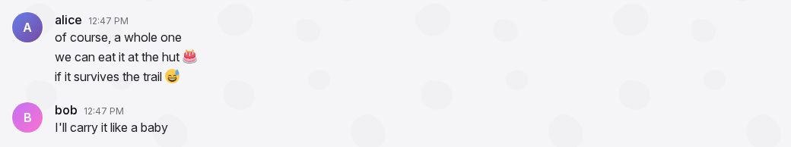
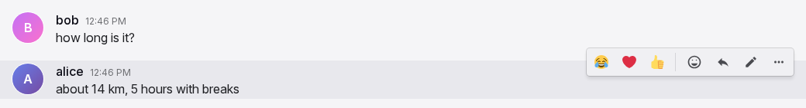
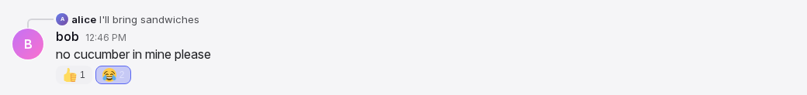
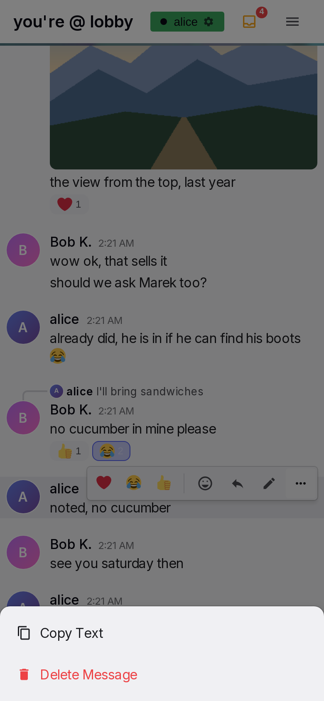

# Message row and actions

A message row is one message as it appears in the conversation. The row shows who wrote the message and when, the text or media, the message it replies to, its reactions, and the actions that the reader can do on it. Rows from the same author within one hour make a group under one header. The reader does all actions on a message in its row. These actions are react, reply, edit, delete, copy and open media. "Phone" on this page means a window 600 px wide or less, as in the [general rules](general-rules.md#GEN-14).

## Anatomy

1. **Avatar.** A 40 px circle on the left with the profile picture, or a coloured disc with the first letter of the username. It shows only on header rows. Other rows leave the avatar column empty.
2. **Header.** The name, a bot badge if the author is a bot, and the time. It shows only on the first row of a group.
3. **Reply quote.** A line above the header, on replies only. It shows a 16 px avatar, the original author's name and the original text on one line, two lines on a phone. A curved connector joins it to the avatar below.
4. **Content.** The text with links and emoji, the media (images in a gallery, videos, GIFs), or both, with the text above the media as a caption. A row with text can end with "(edited)".
5. **Link cards.** Cards under the text, one for each link with a preview, at most five.
6. **Reaction pills.** Pills under the content with the emoji and the count. The reader's own reactions are highlighted.
7. **Action bar.** A bar at the top right of the row. It shows on hover or after a tap. It contains the quick reactions, Add Reaction, Reply, the GIF star on phones, Edit on own text rows, and More.
8. **Popups.** The reaction picker and the More menu open from the bar; the delete dialog opens from the More menu. On a phone, the picker and the menu are bottom sheets.
9. **System line.** A centred italic line in the lobby when someone joins or leaves. It has no header, no actions and no hover effect.

## Rules

### Header and grouping

**MR-01** A row shows a header (avatar, name, time) when it is the first message shown, when its author is different from the author of the previous message, when it is a reply, or when one hour or more passed since the previous message. Other rows show only their content, aligned to the same text column.

**MR-02** A header row has 17 px of space above it. Rows inside a group have no space above them.

**MR-03** The name is the author's display name, or the username when no display name is set. Emoji in a name show as images at text size.

**MR-04** A bot author has a small robot badge after its name.

**MR-05** The time is small and muted, on the same line as the name. For a message from today, the row shows only the time. For a message from yesterday, the row shows "Yesterday" and the time. For an earlier message from the same year, the row shows the date and the time. For an older message, the row shows the full date and the time. Rows without a header show no time.

**MR-06** Times use the user's time zone, and the date order and clock style from Settings. Until the user changes the date order and the clock style, they follow the language of the browser used at sign-up. The labels update with the clock. When midnight passes, a message from today shows "Yesterday".

**MR-07** The reader's own messages and other people's messages look the same. Only the available actions are different. A tap on the avatar or the name opens nothing. The profile card opens from the sidebar.

**MR-08** When the pointer is over a row, the row has a tint. The tint stays while the picker, menu or dialog of the row is open.

**MR-09** A deleted message disappears for every reader. There is no placeholder and no undo. The groups around it are formed again.

### Text

**MR-10** Text shows as the author typed it. Line breaks are kept, and long words wrap to the next line. There is no formatting syntax and no mention syntax. Only links and emoji are transformed. Typed markup shows as text.

**MR-11** A message contains at most 4000 characters. This is the same limit as in the input box.

**MR-12** These addresses in text become links: addresses that start with http:// or https://, addresses that start with www., and bare domains that end in .com, .org, .net, .io, .dev, .app, .co, .me, .info, .edu or .gov. Punctuation at the end of a link stays outside the link. A closing bracket that balances an opening bracket in the address stays in the link, so an encyclopedia link with brackets in its address stays complete.

**MR-13** A link shows as the author typed it, in the accent colour. It is underlined only on hover. It opens in a new tab. An e-mail address does not become a link, and its domain does not become a link.

**MR-14** An edited text row ends with "(edited)" in small placeholder-coloured text.

### Emoji

**MR-15** Emoji in text show as images from one image set, so every reader sees the same image. The device's own emoji glyphs are not used. A skin tone variant, a flag, a keycap or a joined sequence shows as one image. If the device does not load an emoji image, Yap loads the image again, as for a gallery image (MR-24).

**MR-16** In mixed text, an emoji is 1.2 times the text size. When a message contains only emoji and whitespace, the emoji are 3 times the text size. A link or any other text in the message prevents this larger size.

**MR-17** The author writes a custom pack emoji as ":shortcode:". It shows as the pack image, at the same sizes. An unknown shortcode stays text. A shortcode inside a link stays text.

**MR-18** Emoji images in messages do not appear with a delay while the reader reads.

### Link cards

**MR-19** A text message with links gets one preview card for each link, at most five, in text order. A message with media gets no cards, also for a link in its caption. An admin switch turns off previews for everyone. By default, previews are on.

**MR-20** A card shows the site name, the title and the description of the page, and a thumbnail on the right when the page has one. A card appears only when the page has a title or a description. The description is cut at 300 characters.

**MR-21** The whole card is one link that opens in a new tab. The card has an accent bar on the left. It is at most 520 px wide, and full width on a phone.

**MR-22** A card appears after the server reads the page, a short time after the message. When a card appears, a reader at the bottom of the list stays at the bottom. After a card shows, it stays with the message. An edit that adds or removes a link adds or removes the card for that link. A message from history gets its cards in the same way. The cards appear a short time after the page loads.

**MR-23** When the admin switch for media caching is on, a link to a page whose video or audio the server can download shows a player instead of a card. The site name and the title show above the player. A player downloads nothing until the user starts it.

### Images, videos and GIFs

**MR-24** A message with media shows its text, when it has one, above the media as a caption. One image shows at its own aspect ratio. On desktop, the image is at most 400 px wide and 350 px high. On a phone, it is full width and at most 450 px high. While the image loads, a 4:3 box in the sidebar colour keeps its space. If the device does not load an image, Yap loads it again after 3 s, then 10 s, then 30 s, and again when the connection returns. This applies to gallery images, GIF images and emoji images.

**MR-25** Several images make a gallery of square, cropped thumbnails in rows of two or three, with 4 px gaps. Two or three images make one row. Four make two and two. Five make two and three. Six make three and three. Seven make two, two and three. Eight make two, three and three. Nine make three rows of three. Ten make two, two, three and three.

**MR-26** A tap or click on an image opens the gallery viewer at that image. The viewer contains only the images of this message. The [timeline page](timeline.md) specifies the viewer.

**MR-27** Videos show one above the other, with 4 px gaps. On desktop, each video is at most 400 px wide and 350 px high. On a phone, each video is full width. A video shows its poster frame under a dark tint, with a round play icon. A tap shows the controls and starts the video. When the video ends, or is paused at the start, the tint and the icon show again over the current frame. On an iPhone, a video plays in the full-screen player of the phone.

**MR-28** A GIF keeps its own aspect ratio and is at most 360 px wide. A GIF is never cropped. While its size is unknown, it keeps a 240 px square space. It plays automatically, muted and in a loop. While it loads, a small spinner shows after a quarter second. A tap on a GIF opens nothing. When the GIF no longer exists, the row shows "GIF unavailable".

**MR-29** When the browser blocks autoplay, the next tap or key press anywhere starts every paused GIF.

**MR-30** A GIF has a favourite star at its top right corner. On desktop, the star shows on hover. A favourited star is gold and always shows. A click on the star changes the favourite state and nothing else. On a phone, the corner star only marks a favourite. The user changes the favourite state with the star in the action bar.

**MR-31** On hover, a GIF uploaded to Yap shows "via {name}" at its bottom left corner. The name is the display name of the person who uploaded the GIF. A GIF from the provider shows no name.

### Reply quote

**MR-32** A reply shows the quote line above its header. The quote line contains a 16 px avatar, the original author's display name, and the original text. The text is one line with an ellipsis, and two lines on a phone. For an original with media and no caption, the quote shows "Click to see attachment". The quote shows emoji as small images and shows no links. The quote changes when the original is edited.

**MR-33** A curved connector joins the avatar of the quote to the avatar of the reply. A reply always starts a group, so it always has a header.

**MR-34** A tap or click on the quote scrolls the list to the original message, centred, and tints the original for two seconds. When the original is not loaded yet, it is loaded first.

**MR-35** When the original message is deleted, the quote shows "Original message unavailable". The connector stays. A tap on the quote does nothing.

**MR-36** While the pointer is over the quote, the action bar is hidden so that the quote stays readable.

**MR-37** While the user writes a reply to a message, that message has an accent tint. See [Input box](input-box.md#IB-49).

### Reactions

**MR-38** Reactions show as pills under the content. Each pill shows the emoji at 18 px and the number of people who reacted. The pills are in the order in which each emoji was first used on the message. The pill of a reaction that the reader gave is highlighted with the accent colour.

**MR-39** The tooltip of a pill shows the display names of the people who reacted, in the order of their reactions.

**MR-40** A tap or click on a pill adds the reader's reaction with that emoji, or removes it when the reader already has it. The change shows immediately, before the server answers. See [General rules](general-rules.md).

**MR-41** The action bar starts with three quick reactions. These are the three emoji that the reader uses most in reactions. When there are fewer than three, ❤️, 😂 and 👍 fill the set until there are three. Only reactions count. Emoji typed into messages do not change the quick set.

**MR-42** Add Reaction opens the emoji picker for this message, with search, recent emoji, the custom packs and the categories, as on the [pickers page](pickers.md#PK-43). A pick closes the picker and adds or removes that reaction. On desktop, the picker opens below the button. When there is no space below, it opens above the button. It always stays inside the window. On a phone, the picker is a bottom sheet.

**MR-43** While the picker is open, the row keeps its action bar and its tint. A tap outside the picker, or Escape, closes the picker and does nothing else.

**MR-44** A reaction also moves the emoji to the front of the reader's recent emoji.

**MR-45** All people who can see a message can react to it. This includes their own messages, and rooms where they have no permission to write. There is no limit on reactions. System lines do not accept reactions.

### Action bar

**MR-46** On desktop, the bar shows at the top right of the row while the pointer is over the row. It also shows while one of its buttons has keyboard focus. It stays while the picker, menu or dialog of the row is open. It does not show on system lines or while the user edits the row.

**MR-47** The buttons are in this order: the three quick reactions, a divider, Add Reaction, Reply, the GIF star on phones, Edit on the reader's own text rows, More. More is present when the row has text to copy or when the row is the reader's own.

**MR-48** The icons are 18 px. The Add Reaction icon is 20 px. The buttons get a tint on hover and become slightly smaller while pressed.

**MR-49** Reply opens the reply bar in the input box and moves focus into the draft in the same tap. See [Input box](input-box.md#IB-50).

**MR-50** On a touch screen, a tap on a row shows its bar. Only one row shows a bar at a time. The tap that shows the bar also acts on the tapped item: a link opens, a pill toggles, an image opens the viewer. The bar appears after the tap, never under the finger. A scroll gesture does not show a bar.

**MR-51** On a touch screen, the bar is hidden 5 s after the last touch in the row, or after the list scrolls more than 50 px. Touches in the picker, menu or dialog of the row count as touches in the row. The tap that closes the picker, the menu or the dialog is also a touch in the row. The bar is never hidden while one of them is open. When the row changes while its bar shows, for example when a reaction arrives, the bar stays. An open picker or menu also stays. A mouse on a device with touch input uses the hover rule.

**MR-52** On a phone, the buttons of the bar are larger. The bar also contains the GIF star for the first GIF of the row.

**MR-53** A long press on a row does nothing.

### More menu

**MR-54** More opens a menu. The menu contains "Copy Text" when the row has text, and "Delete Message" in red on the reader's own rows. On desktop, the menu is a dropdown below the button. When there is no space below, it opens above the button. On a phone, the menu is a bottom sheet over a dimmed page.

**MR-55** A tap outside the menu closes the menu and does not press anything under it. Escape closes the menu. A scroll does not close the menu. This includes the scroll that occurs when a phone keyboard closes.

**MR-56** Copy Text copies the message text as the author typed it, with shortcodes and links as text. The menu closes. There is no other feedback.

### Editing

**MR-57** The author can edit their own text rows, and the caption of their own media rows, at any time. A media row without a caption cannot be edited. Admins cannot edit other people's messages.

**MR-58** Edit replaces the text with an editor in the same row. The header stays, and the media of a captioned row stays. The editor starts with the current text and looks like the input box. It grows to 200 px, then scrolls. Below the editor are "✓ Save", "✕ Cancel" and, on desktop, the hint "Enter to save · Shift+Enter for newline · Esc to cancel".

**MR-59** The editor gets focus, with the caret at the end. On a phone, a closed keyboard stays closed. An open keyboard stays open and types into the editor.

**MR-60** On a device without touch input, Enter saves and Shift+Enter adds a new line. On a device with touch input, Enter adds a new line. Escape cancels the edit. During input method composition, Enter and Escape do nothing.

**MR-61** When the text is unchanged, empty or only whitespace, Save closes the editor and changes nothing. When the text is changed, Save updates the message for every reader and adds "(edited)". The edited text contains at most 4000 characters.

**MR-62** Only one editor is open at a time. Edit on another row discards the draft of the first editor. While the user edits a row, its action bar is hidden. The row continues to receive live changes, and its link cards stay visible. When the message is deleted elsewhere, the editor disappears.

**MR-63** Nothing typed in the editor is sent to the server before Save.

### Delete

**MR-64** The author can delete their own messages at any time. This includes media rows. Admins cannot delete other people's messages.

**MR-65** Delete Message opens a dialog over the whole page. The dialog contains "Delete Message", "Are you sure you want to delete this message?", a preview of the message, and the buttons "Cancel" and "Delete". The preview shows the avatar, the name, the time, and up to three lines of text or the first image, video poster or "GIF attachment". On desktop, a tip tells the user to hold Shift to skip the dialog.

**MR-66** Delete has focus when the dialog opens, so Enter confirms the delete. Escape, Cancel and a tap on the dimmed area cancel the delete. On a phone, the buttons are full width, one above the other, with Delete above Cancel. There is no tip on a phone.

**MR-67** Shift+click on "Delete Message" deletes the message immediately, without the dialog.

**MR-68** After a delete, the row disappears immediately for every reader. Replies to the message keep their header and show "Original message unavailable".

### Pending and failed messages

**MR-69** When the reader sends a message, it appears immediately as a full row, faded, at the end of the list. The header rules of a normal row apply to it. It becomes a normal row when the server accepts it. Messages sent quickly keep their order.

**MR-70** While files upload, the pending row shows the file names, one progress bar for the message, and "Cancel upload". Cancel removes the pending message.

**MR-71** When a message cannot be sent, its row shows "Failed", the reason, "Retry" and "Remove". Remove deletes the message from this device only. A message that waited more than one day shows as failed.

**MR-72** A pending message offers Edit on text rows. Under More, it offers Copy Text and Remove. All three act on the device. A pending message offers no reactions and no Reply.

### System lines and bot rows

**MR-73** In the lobby, a centred italic line appears when a person joins or leaves. The [presence page](presence.md#PR-17) specifies when it appears. The line shows a random text from the configured lists, with the username of the person. Invisible people get no line. The line is not stored, so a reload removes it.

**MR-74** A bot message can contain an "install it" link. The link opens the install dialog. See [Offline and installation](offline.md).

### Without a connection

**MR-75** Reactions, edits, deletes and the GIF star need a connection. Without a connection, these actions change nothing: a tap on a pill, a quick reaction, a pick in the reaction picker, the star, Save and Delete. They show "Needs a connection" at the row for two seconds. Pending messages are an exception. Their Edit and Remove act on the device. Reply and Copy Text work as usual. Media that the reader saw before also opens as usual.

## States

| State or trigger | Input | What the user sees |
| --- | --- | --- |
| Same author within an hour | all | One header, then rows without avatar, name or time. |
| Author change, reply, or an hour passed | all | A new header with 17 px above it. |
| Pointer over a row | mouse | Row tinted, action bar at the top right. |
| Keyboard focus on a bar button | keyboard | The bar is visible. |
| Pointer over the reply quote | mouse | The bar is hidden. |
| Tap on a row | touch | The bar shows after the tap. The tapped item does its action. The bars of other rows are hidden. |
| Scroll gesture that starts on a row | touch | The list scrolls. The bar does not show. |
| 5 s without a touch, or a 50 px scroll | touch | The bar fades out. Not while a picker, menu or dialog is open. |
| Long press | touch | Nothing. |
| Tap on a pill | mouse, touch | The reader's reaction toggles immediately. The pill highlight and count change. |
| Pointer over a pill | mouse | Tooltip with the display names, in reaction order. |
| Quick reaction tap | mouse, touch | Reaction toggled immediately. |
| Add Reaction | mouse, touch | Picker below the button (desktop) or bottom sheet (phone). Row keeps bar and tint. |
| Pick in the picker | mouse, touch | Picker closes; reaction toggled; emoji moved to the front of recents. |
| Tap outside the picker, Escape | mouse, touch, keyboard | Picker closes. Nothing else happens. |
| Reply | mouse, touch | Reply bar in the input box, draft focused, row tinted. |
| More | mouse, touch | Dropdown (desktop) or bottom sheet (phone) with Copy Text when the row has text and, on own rows, Delete Message. |
| Tap outside the menu | mouse, touch | Menu closes. Nothing under it is pressed. |
| Scroll with the menu open | touch | Menu stays open. |
| Copy Text | mouse, touch | Text copied as typed; menu closes. |
| Edit | mouse, touch | Editor in the row, caret at the end, bar hidden. Phone: keyboard state unchanged. |
| Enter in the editor | keyboard, device without touch | Saves. |
| Enter in the editor | keyboard, device with touch | Newline. |
| Escape in the editor | keyboard | Cancels. |
| Save, unchanged or empty | all | Editor closes, message unchanged. |
| Save, changed | all | New text for everyone, "(edited)" appended. |
| Delete Message | mouse, touch | Dialog over the page with the preview; Delete focused. |
| Shift+click Delete Message | mouse | Deleted immediately. |
| Enter, Escape, tap on the dimmed area | keyboard, mouse, touch | Confirms, cancels, cancels. |
| Message deleted | all | Row disappears for everyone. Replies show "Original message unavailable". |
| Tap on the quote | mouse, touch | List scrolls to the original, centred, tinted for 2 s. Older messages load if necessary. |
| Tap on an image | mouse, touch | Gallery viewer with the images of this message. |
| Tap on a video | mouse, touch | Controls visible, video plays. On an iPhone, the full-screen player opens. |
| Video ends | all | Tint and play icon show again over the current frame. |
| GIF loading | all | Spinner after 0.25 s. |
| Autoplay blocked | all | The next tap or key press starts all GIFs. |
| Pointer over a GIF | mouse | Corner star and "via {name}". |
| Corner star tap | mouse | Favourite toggled; nothing else. |
| Bar star tap | touch | Favourite toggled; nothing else. |
| Link in text | mouse, touch | Opens in a new tab. |
| Card appears | all | Card under the text. A reader at the bottom stays at the bottom. |
| Own message sent | all | Faded full row at the end, immediately. |
| Message accepted | all | Row becomes normal. |
| Send failed | all | "Failed", reason, Retry, Remove. |
| Files uploading | all | File names, progress bar, "Cancel upload". |
| No connection, reaction, star, Save or Delete | all | Nothing changes. "Needs a connection" at the row for 2 s. |
| Someone joins or leaves the lobby | all | Centred italic system line. |

## Wording

| Where | Text |
| --- | --- |
| Edited marker | "(edited)" |
| Avatar tooltip | the display name |
| Bot badge tooltip | "Bot" |
| Bot install link | "install it" |
| Time, yesterday | "Yesterday {time}" |
| Quote of a media-only original | "Click to see attachment" |
| Quote of a deleted original | "Original message unavailable" |
| Image alt text | "Uploaded image" |
| GIF missing | "GIF unavailable" |
| GIF sender | "via {name}"; tooltip "Uploaded by {name}" |
| GIF star tooltips | "Add to favorites"; "Remove from favorites" |
| Bar tooltips | the emoji itself; "Add Reaction"; "Reply"; "Edit"; "More" |
| Video play control | "Play video" |
| More menu | "Copy Text"; "Delete Message" |
| Editor | "✓ Save" (tooltip "Save"); "✕ Cancel" (tooltip "Cancel"); "Enter to save · Shift+Enter for newline · Esc to cancel" |
| Delete dialog | "Delete Message"; "Are you sure you want to delete this message?"; "GIF attachment"; preview alt texts "Attachment", "Video attachment"; "Pro tip: hold Shift when deleting to skip this confirmation." with Shift as a keycap; "Cancel"; "Delete" |
| Pending row | "Cancel upload"; "Failed"; "Retry"; "Remove"; the reason is the server's refusal text, or "Could not send" when there is none |
| Reaction tooltip | the display names joined with ", " |
| Without a connection | "Needs a connection" |
| Lobby join lines (configured; defaults) | "{0} just dropped", "{0} is here", "{0} arrives", "W {0} joined", "{0} spawned in", "{0} returns" |
| Lobby leave lines (configured; defaults) | "{0} dipped", "{0} ghosted us", "{0} went to touch grass", "{0} logged off", "{0} left on read", "{0} has left the chat", "rip {0}" |
| Lobby lines when the lists are missing | "{0} joined the chat"; "{0} left the chat" |

## Related

- [Input box](input-box.md) for sending, the reply bar and the pending row's origin.
- [Emoji and GIF pickers](pickers.md) for the reaction picker's content.
- [Timeline and media](timeline.md) for the list, scrolling, the gallery viewer and loading older messages.
- [Settings](settings.md) for the time zone, date order and clock style.
- [Administration](admin.md) for the link preview and media caching switches.
- [Offline and installation](offline.md) for queued messages and installing Yap.
- [Presence](presence.md) for the lobby join and leave lines.
