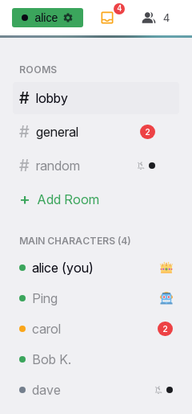

# Notifications and unread

Unread counts and notifications tell a person about new messages. This page specifies what is unread, when it becomes read and what the counts show. It specifies when a sound plays and what a mute silences. It also specifies when a device receives a notification while Yap is not visible. The [frame page](frame.md) shows where the numbers appear. This page gives the rules that produce the numbers.

## Rules

### What is unread

**NT-01** Every conversation has one unread count for each person. The count belongs to the account. Every device of the person shows the same number. A read on one device clears the count on all devices at once.

**NT-02** Only a new message increases a count. Edits, deletions, reactions, typing and presence never change it. The sender's own messages never count, also when the sender uses another device. Bot messages count like the messages of a person. A system line such as "{name} pinned a message" ([MR-80](message-row.md#MR-80)) never counts and sends no notification.

**NT-03** A direct message counts for the other person, online or not. A room message counts for every person who has Yap open on any device at that moment, whatever their status. It also counts for every person who has that room unmuted. It does not count for a person who is reading the room at that moment (NT-07). A person who is offline and has the room muted gets nothing. That person gets no count and no dot. *Why:* a person who opens Yap again should not find many dots in the sidebar for rooms that the person never opened.

**NT-04** A mute never stops the count for a person who receives it. A muted conversation shows a dot instead of its number. When the person unmutes the conversation, its true count appears.

**NT-05** Counts stay after a reload and after a server restart. A sign-out does not clear them.

### When a conversation becomes read

**NT-06** Opening a conversation marks it read, whatever the status and the visibility. This includes a tap in the sidebar, a link, a notification tap and a switch from another conversation. Leaving a conversation for Settings or another page marks it read when the page was visible and the person was not away.

**NT-07** A message that arrives in the open conversation never counts for a person who is reading it: the conversation is open on a device, the page is visible, and the person is not away and not idle. The server decides this from the session, so no device shows a count. The view position stays on the client: a person scrolled up in history gets the new-messages pill (TL-13) instead of a count. When the conditions are not met (a hidden tab, an away or idle person), the message counts and stays unread until the client marks the conversation read. The client marks it read when the page is visible, the person is not away, and the view is at the bottom. A desktop window that is visible but not focused counts as visible. *Why:* in a busy room every member is a reader, and a count plus a mark-read per message per member was most of the unread work on the server.

**NT-08** A read clears the whole conversation. Yap has no partial read, no divider and no "mark all as read".

### Counts, total and badges

**NT-09** A conversation's row shows its count when it is unmuted, a dot when it is muted, and nothing when it is the open conversation.

**NT-10** The total in the mailbox is the sum of the counts of the unmuted conversations. It does not include the open conversation. It equals the sum of the numbers that the rows show.

**NT-11** The icon badge of the installed app shows the sum of the unread counts of the unmuted conversations. The sum includes the open conversation. The badge updates while the app is open, and when a notification arrives while the app is closed. A suppressed or muted message does not change the badge. A read on another device corrects the badge at the next notification or the next open of the app.

**NT-12** While the tab is hidden, the tab title starts with a number. The number counts the messages that raised an unread count after the tab became hidden. A message that the person reads on another device at that moment adds nothing. The mute rules below apply to this number. The number resets when the tab becomes visible again. On a room page, every unmuted conversation counts. On a direct message page, only direct messages count.

### Sound

**NT-13** A sound plays when a direct message from another person arrives while the tab is hidden and a direct message page is open. No sound plays when the arriving direct message is muted. The sound never plays on a room page, while the tab is visible, or for the person's own messages. Status has no effect on the sound.

**NT-14** One arrival plays one sound, whatever the number of tabs.

**NT-15** The person cannot change the sound or turn it off. To silence the sound, the person uses a mute.

### Mutes

**NT-16** Mutes have three levels: the whole server, then all direct messages or all rooms, then one conversation. Yap checks the levels from the top down. The first level that decides applies.

**NT-17** The server-wide mute has a duration of 1 hour, 1 day, 1 week, or until the person turns notifications back on. A new mute starts as "Until I turn it back on". A duration pick counts from the moment of the pick. The highlighted duration is the shortest one that still covers the remaining time. While the mute is on, the status menu shows a crossed bell. Settings then hides the direct message and room rows.

**NT-18** Direct messages and rooms each have a mode: "Allow all", "Individual" or "Mute all". In Individual mode, every conversation has its own bell. New direct messages follow the "New DMs" bell. A new room is muted until the person allows it.

**NT-19** A new account has these defaults: the server is allowed, direct messages are allowed, and rooms are muted.

**NT-20** The conversation that receives a message decides. Its mute setting applies to the count, the total, the badge, the sound, the tab title and the notification. The setting of the open conversation has no effect.

**NT-21** When something arrives in a muted conversation, the conversation shows a dot and nothing else. There is no number, no sound, no notification and no move to the top of the people list. The choices for each conversation stay after a switch of mode. They apply again when the person switches back.

**NT-22** Mutes belong to the account and apply on every device. The person sets them only in Settings, under "Allow / Mute Notifications". A change applies from the next message.

### Notifications on a device

**NT-23** Any browser that supports notifications, and the installed app, can receive notifications while Yap is not open. A browser on an iPhone or iPad cannot; there, only the installed app can. The person turns notifications on per device in Settings, or from the "One more step" prompt in the installed app. Each browser and each installed app counts as its own device, also on the same phone.

**NT-24** The subscription of a device belongs to the account that is signed in on the device. A sign-out removes the subscription. "Sign out all other devices" also removes the subscriptions of the other devices. When a second account signs in on the device, the first account's subscription is removed, and the second account can make its own. When the person turns push off on a device, push stays off until the person enables it again. Yap never subscribes a device silently.

**NT-25** For a direct message, Yap sends a notification to the other person. For a room message, Yap sends a notification to every person who has that room unmuted, except the sender.

**NT-26** Yap sends no notification to a person who is online and has a visible Yap session on any device. Away, chosen or automatic, does not suppress notifications. When a person is away, the phone should show the notification, and an idle desktop tab must not suppress it. Invisible also does not suppress notifications. A hidden tab suppresses nothing.

**NT-27** A direct message notification has the title "DM from {display name}". Its body is the message text as typed, including shortcodes. A room notification has the title "#{room}" and the body "{display name}: {text}". A message with media and a caption shows the caption. A message with a GIF and no caption shows "[GIF]". A message with images or videos and no caption shows "[Attachment]". A voice message shows "[Voice message m:ss]" with its length. A body longer than 100 characters is cut and ends with "...". A new notification of a conversation replaces the previous one and alerts again.

**NT-28** A tap on a notification opens that conversation in an open Yap window, or in a new window. The notification contains the unread total for the icon badge. A read in the app does not remove a notification that is already shown.

**NT-29** Yap sends a separate notification for every message at once. There is no delay for grouping and no summary message.

**NT-30** "Send a test to all my devices" in Settings sends a notification to every subscribed device. The test ignores every mute and does not change the badge.

**NT-31** The notification prompt shows only in the installed app, and only while the browser is not yet asked for permission. It stops after three dismissals. A refusal in the browser stops it permanently. The person can still enable notifications in Settings when the browser allows it. See [frame page](frame.md#SH-38).

## States

| State or trigger | Input | What the user sees |
| --- | --- | --- |
| Message in an unmuted room, person online elsewhere | all | Red count on the row; the total increases; a notification only if the room is unmuted and no session is visible. |
| Message in a muted room | all | Dot on the row for a person with Yap open; nothing for an offline person. |
| Direct message, person offline | all | Count on the row when the person next opens Yap; notification on every subscribed device. |
| Direct message, tab hidden on a direct message page | all | Sound; title "(1) …"; a count unless it is the open conversation; no notification if the person is online with a visible session elsewhere. |
| Direct message, online with a visible session anywhere | all | No notification; sound and counts as in the rows above. |
| Open conversation, visible, not away, at the bottom | all | The new message is read at once; no count on any device. |
| Open conversation, away or hidden | all | Stays unread; read when the person returns. |
| Open conversation, scrolled up | all | Stays unread until the view reaches the bottom; the pill shows. |
| Read on the phone | all | Desktop row and mailbox clear at once. |
| Tab becomes visible again | all | Title prefix gone; open conversation read if at the bottom and not away. |
| Server mute on | all | Crossed bell in the status menu; no sounds or notifications; counts continue as dots. |
| Timed mute ends | all | The settings of the lower levels apply again. |
| Unmute a conversation | all | Its true count appears. |
| Notification tap | touch, mouse | The conversation opens and is read. |
| Test send | mouse, touch | Every device shows the test banner; the result line shows for 3 s. |

## Wording

| Where | Text |
| --- | --- |
| Direct message notification | "DM from {display name}"; body "{text}", "[GIF]" or "[Attachment]" |
| Room notification | "#{room}"; body "{display name}: {text}" |
| Notification when the content is missing | "New Message"; "You have a new message"; it opens the start page |
| Test notification | "{name} test notification"; "If you can see this, notifications work on this device." |
| Tab title prefix | "({n}) " |
| Mailbox tooltip | "{n} unread messages" |
| Sidebar bell tooltip | "Notifications muted" |
| Settings, device card | {name} is the server's name, {device} is "iPhone", "iPad", "phone" or "computer", {browser} is "Safari", "Chrome", "Firefox", "Edge" or "This browser". Heading "Notifications on This {Device}". The intro by situation: the installed app on a phone "When {name} is closed, new messages show as notifications on this {device}, with a number on the {name} icon. Your {device} treats {name} like any other app. You can also change this in your {device}'s Settings, under Notifications."; a browser on an iPhone or iPad "{browser} cannot show {name} notifications. First add {name} to your home screen (see Install as App above). Then open the {name} icon and turn notifications on there. The app shows new messages like any other app, with a number on its icon."; a browser on an Android phone "When this tab is closed, new messages show in your phone's notifications. For a number on an icon, install {name} on your home screen (see Install as App above)."; the installed app on a computer "When {name} is closed, new messages show as a pop-up in the corner of your screen. The number of unread messages shows on the {name} icon in your taskbar or dock."; a browser on a computer "When this tab is closed, new messages show as a pop-up in the corner of your screen. While the tab is open, the number of unread messages shows in the tab title.". Rows "This {device}" with "On", "Off", "Blocked", "Not possible here" or "Not set up on this server"; "Phones and computers" with the count or "none yet"; the list with "This device", "Added {time}", "Delivered {time}", "Remove" (tooltip "Remove this device"); platform hints "Apple (Safari / iOS)", "Google (Chrome / Edge / Android)", "Mozilla (Firefox)", "Microsoft (WNS)", "Notification device"; times "just now", "{n}s ago", "{n}m ago", "{n}h ago", "{n}d ago" |
| Settings, device actions | "Turn on notifications on this {device}"; "Turning on..."; "Your {device} will ask you to allow notifications. Tap Allow." (on a computer "Your browser will ask you to allow notifications. Click Allow."); "Turn off notifications on this {device}"; "Turning off..."; "Your other phones and computers keep theirs. Use Remove in the list to drop one."; "Send a test to all my devices"; "Sending..."; "Each phone and computer in the list gets a test. One that stays quiet is not set up."; footer "This switch only decides whether notifications reach this {device}. Which messages notify you is set in Allow / Mute Notifications below. Rooms are quiet until you allow them. You get no notification while {name} is open on your screen on any device." |
| Settings, device hints | "This browser cannot show notifications."; "Notifications are not set up on this server."; after a block, the steps for the place: the app on an iPhone or iPad "Notifications for {name} are turned off on this {device}. Open the Settings app, tap Notifications, scroll to {name}, and turn on Allow Notifications. Then come back here and tap Turn on."; the app on an Android phone "Notifications for {name} are turned off on this phone. Press and hold the {name} icon on your home screen, tap App info, tap Notifications, and turn them on. Then come back here and tap Turn on."; the app on a computer "Notifications for {name} are turned off. Click the three dots at the top of the {name} window, choose App info, set Notifications to Allow, and open the app again."; a browser on an Android phone "Notifications are blocked for this site. Tap the lock icon next to the address, tap Permissions, then Notifications, and choose Allow. Then reload this page."; Firefox "Notifications are blocked for this site. Click the icon on the left of the address bar, remove the Blocked entry next to Notifications, and reload this page."; Safari on a Mac "Notifications are blocked for this site. In the Safari menu, open Settings, then Websites, then Notifications. Set this site to Allow and reload this page."; any other browser on a computer "Notifications are blocked for this site. Click the icon on the left of the address bar, set Notifications to Allow, and reload this page." |
| Settings, red notice | "This {device} does not show notifications when {name} is closed. Turn them on in Notifications on This {Device} above."; "Notifications are blocked on this {device}. See Notifications on This {Device} above for the fix."; "{browser} cannot show notifications. Install {name} on your home screen to get them."; "This browser cannot show notifications when {name} is closed." |
| Settings, results | "No phone or computer gets notifications yet."; "Sent to {n} device(s). Check them now."; "Sent to {sent} of {total} devices. {failed} could not be reached and the dead ones were removed."; "Failed to send test notification."; "Notifications stay off. You closed the question without choosing Allow."; "This browser could not reach its notification service ({error}). A firewall or an ad blocker can cause this. In Brave, turn on \"Use Google services for push messaging\"." with "unknown error" when the browser gives none; "{browser} cannot show {name} notifications. Add {name} to your home screen first." |
| Settings, rules section | "Allow / Mute Notifications"; "Choose what actually notifies you. These rules follow your account on every device."; "This server"; "Allow"; "Mute"; "Mute for"; "1 hour"; "1 day"; "1 week"; "Until I turn it back on"; "Muted for another {time}."; "Muted until you turn notifications back on."; "Direct messages"; "Rooms"; "Allow all"; "Individual"; "Mute all"; "New DMs"; tooltips "Allowed — click to mute", "Muted — click to allow" |
| Settings, footer | "A muted room or DM still shows a small dot in the sidebar when something arrives. It sends no notification, plays no sound, and adds nothing to the unread count." |
| Prompt | "One more step"; "Turn on notifications, and this {device} shows new messages when {name} is closed. You can change this any time in Settings."; "Enable Notifications"; "Enabling..."; "Maybe Later" |
| Accessible names in Settings | "Server notifications"; "Mute duration"; "Mute"; "Unmute" |

## Related

- [Header, sidebar and overlays](frame.md) for the rows, the mailbox, the title and the prompt.
- [Timeline and media](timeline.md) for the view following the bottom and the New messages pill.
- [Presence](presence.md) for away and visible sessions.
- [Settings](settings.md) for the two notification sections.
- [Administration](admin.md) for the notification audit admins see.
- [Offline and installation](offline.md) for the installed app.
