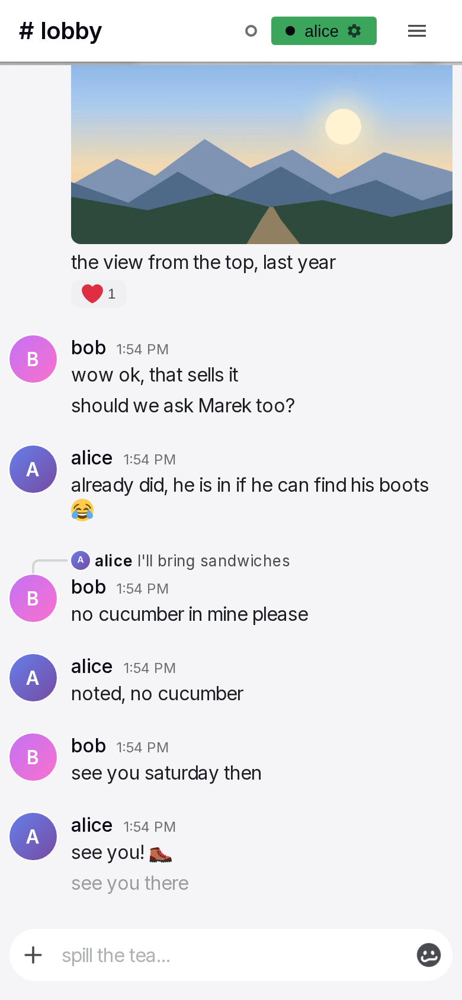

# Offline and installation

Yap runs in the browser and can also be installed as an app on a phone or a desktop. Without a connection, the user can still read conversations, and Yap keeps what the user writes. This page specifies what the installed app is, what works without a connection, and what happens to messages written offline. The design is in `docs/offline-design-notes.md`. The promise on this page is intentionally limited. Yap is not a critical system. The loss of a message on rare occasions is acceptable. A delay of one second on every tap is not acceptable.

## Rules

### Installation

**OF-01** The user can install Yap from the bot's welcome message ("install it"), from Settings ("Install Yap"), or from the browser's own install control. The install dialog first explains how to replace an older install. Then it starts the browser's install or shows the add-to-home-screen guide. When Yap is already installed, the dialog says so.

**OF-02** The installed app opens full screen, with the Yap icon, name and colours. It starts on the user's last conversation, or on the lobby if there is none.

**OF-03** When the app is installed from a signed-in browser, it signs in automatically on its first launch, within 72 hours after the install. An app that still starts signed out shows the login page, as the [sign-in page](sessions.md#AU-24) says. After its first sign-in, the app keeps its own session, like any device.

**OF-04** The notice strip announces a new version of Yap with "Reload". Yap never reloads an open page automatically. A page not yet opened in this visit loads fresh ([SH-50](frame.md#SH-50)). A reload keeps drafts and unsent messages.

### Without a connection

**OF-05** The header shows the connection state. It shows a grey ring while the device is offline and a pulsing orange dot while it reconnects. No banner covers the content. Other people see the person as away after 30 seconds and as offline after 5 minutes, as the [presence page](presence.md#PR-15) says. A device that is signed out from elsewhere receives the sign-out when the connection returns.

**OF-06** Every conversation that the user opened on this device shows its last messages. The user can read and scroll it, also after a reload. When older messages were not loaded, the top of the list shows "Needs a connection". Media that was seen before shows. Media that was not seen before shows "Needs a connection" in its place.

**OF-07** Typing, drafts, emoji, the emoji picker, the GIF picker's own lists, a switch between conversations and reading all work without a connection. Settings and Administration need a connection.

**OF-08** Sending works without a connection, also in a conversation that the user never opened on the device. Send accepts the message, shows it as pending in the conversation and keeps it on the device. Yap sends the message when the connection returns, also after the app was closed and opened again.

**OF-09** Without a connection, the tray of the input box holds files up to 25 MB in total. Yap refuses a pick or a send that goes over this, and the input box shows "Needs a connection".

**OF-10** Yap sends pending messages in the order in which the user wrote them, as soon as a connection exists. The user sees each one change into a normal message. The user does not have to do anything. An upload that stopped when the network changed goes on when the connection returns, with the files that are not done.

**OF-11** When the server refuses a pending message, the message shows as failed, with the reason, "Retry" and "Remove". A pending message that waits for more than one day also shows as failed. Remove deletes the message from the device only.

**OF-12** Reactions, edits and deletions of sent messages, the GIF star, GIF uploads, search and trending need a connection. When the user tries one of them, Yap shows "Needs a connection" there, and nothing changes. A GIF pick is queued like a message. The user can still edit and remove a pending message on the device. The status items in the status menu are dimmed.

**OF-13** Yap reconnects automatically when the network returns and when the tab becomes visible again. It also reconnects when the user taps the connection dot. The tap also shows the bubble of the dot. Yap then refreshes the newest messages and corrects the unread counts. The view keeps its position.

### The promise and its limits

**OF-14** Reading without a connection shows what the device already has. Yap does not download in advance any conversation that the user did not open.

**OF-15** Sending later is best effort. A message is lost with no indication when the device loses its storage or when another account signs in on the device. In every other case, a message that cannot be sent shows as failed.

**OF-16** A sign-out removes every draft, pending message, cached conversation and notification subscription of the previous account. A sign-in of a different account on the device does the same.

**OF-17** When Yap is open in several tabs, one tab sends the pending messages of all of them. A tab that shows the new-version notice ([SH-20](frame.md#SH-20)) hands this over to a tab on the new version, when one is open, and takes it back when no such tab is left. Messages written in the old tab still go out.

## States

| State or trigger | Input | What the user sees |
| --- | --- | --- |
| "install it" or "Install Yap" | touch, mouse | Install dialog; then the browser's install or the guide. |
| Installed app launched | touch | Full screen, last conversation; signed in when installed from a signed-in browser within 72 hours, else the login page. |
| New version | all | Notice strip with "Reload"; nothing changes until the tap. |
| Connection lost | all | Grey ring; everything readable. |
| Open a conversation seen before | all | Its last messages at once. |
| Open a conversation never seen | all | Header and empty list with "Needs a connection". |
| Send a text | keyboard, touch | Pending row at the end at once. |
| Files picked without a connection, under 25 MB | touch, mouse | Pending row with the files. |
| Files picked without a connection, over 25 MB | touch, mouse | The pick is refused; "Needs a connection" in the input box. |
| Reaction, edit or delete on a sent message | touch, mouse | "Needs a connection" at the row. |
| Connection returns | all | Pending rows become normal rows in order; counts corrected; view unchanged. |
| Server refuses a pending message | all | "Failed", reason, "Retry", "Remove". |
| Pending for more than a day | all | Shown as failed. |
| App closed with pending messages, reopened online | touch | They are sent. |
| Sign out | touch, mouse | Device data removed; a confirmation first when pending messages exist. |

## Wording

| Where | Text |
| --- | --- |
| Install dialog | see the [frame page](frame.md#SH-40) |
| Settings, install section | "Install as App"; "Install Yap to your home screen for a full-screen experience with push notifications and quick access."; "Install Yap"; "Yap is installed as an app on this device." |
| Bot welcome, phones | "📱 I noticed you're on a phone. It's a much better experience if you install it to your homescreen — it will look and feel like a normal app. Please also allow notifications when prompted so you don't miss messages. You can change this anytime in Settings." |
| New version | "You are awesome and so is the new version of this app. Please refresh."; "Reload" |
| Connection bubble | "Offline. Messages are sent when the connection returns."; "Reconnecting…" |
| Top of the list without older messages | "Needs a connection" |
| Row actions and media not seen before, without a connection | "Needs a connection" |
| Input box, too much to queue | "Needs a connection" |
| Failed message | "Failed"; "Retry"; "Remove" |

## Related

- [Input box](input-box.md) for sending and the pending row.
- [Message row and actions](message-row.md) for the pending and failed rows.
- [Timeline and media](timeline.md) for what the list shows without a connection.
- [Header, sidebar and overlays](frame.md) for the connection state and the install dialog.
- [Notifications and unread](notifications.md) for notifications on the installed app.
- [Sign-in and sessions](sessions.md) for the installed app's session.
