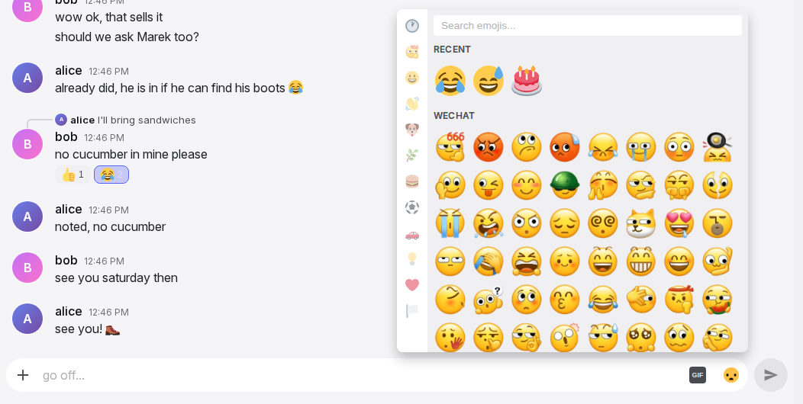
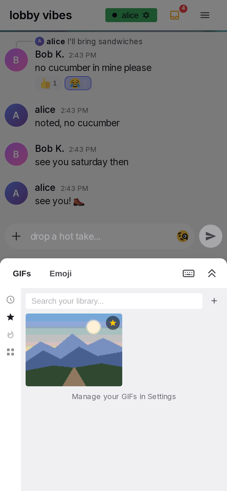

# Emoji and GIF pickers

The emoji picker and the GIF picker open from the input box. The emoji picker puts an emoji into the draft. The GIF picker sends a GIF. The emoji picker also opens from the action bar of a message, to add a reaction. On desktop, each picker shows above the input box. On a phone, the two pickers share one bottom sheet with two tabs. All actions inside the pickers have an immediate result. Only GIF search, trending, uploads and sends use the network.

## Anatomy

1. **Category bar.** A 40 px rail on the left of the emoji picker, with one icon for each section: Recent, each custom pack, then the ten categories. The icon of the section in view is highlighted.
2. **Emoji search.** A search field with a clear button, at the top of the grid. Results update on every keystroke.
3. **Emoji grid.** Sections, each with a header in small capitals: Recent, the custom packs, then the categories. Each cell is 48 px with a 40 px image. On a phone, each cell is 36 px with a 28 px image.
4. **GIF rail.** A 40 px rail on the left of the GIF picker, with the tabs Recent, Favorites, Server library and Browse.
5. **GIF search row.** The search field, its clear button, a spinner and the upload button. The spinner shows while the provider searches.
6. **GIF results.** A two-column masonry layout of cards. Each card has the aspect ratio of its GIF and plays a preview. Library cards have a favourite star.
7. **Attribution.** A small "Powered by Klipy" badge in a footer strip. It shows while provider results show.
8. **Phone sheet.** One bottom sheet with the tabs "GIFs" and "Emoji". At the right end of the tab row, a keyboard button and a button with two chevrons. The [input box page](input-box.md#IB-41) gives the height of the sheet.

## Rules

### Emoji picker

**PK-01** On desktop, the emoji picker is 460 px wide and at most 450 px high. It has no title, no close button and no footer. It closes as the [input box](input-box.md#IB-42) describes. It also closes on Escape and when the window width crosses 600 px.

**PK-02** The sections are in this order: Recent, the custom packs ("Custom" from the server first, then the built-in packs A to Z), then the categories Smileys, Gestures, Animals, Nature, Food, Activities, Travel, Objects, Symbols, Flags. Each section has a header in small capitals.

**PK-03** The category bar has one button for each section, in the same order. The buttons are a clock for Recent, the first image of each pack, and one emoji for each category. The button of the section at the top of the view is highlighted. The highlight changes when the grid scrolls.

**PK-04** A tap on a category button clears the search. The grid then scrolls until the header of the section is directly below the search field. This does not wait for the server.

**PK-05** Each emoji shows as an image from the same set as in messages, 40 px in a 48 px cell. Each emoji is in exactly one category. There is no skin tone chooser. Each cell shows one fixed emoji.

**PK-06** The search compares the typed text with each emoji's keywords, and with each pack emoji's shortcode and pack keywords. Results update on every keystroke. Results stay grouped under their section headers, with Recent first. A section without a hit is not shown. When there is no hit, the picker shows "No emojis found". The clear button, a category tap and a reopen all clear the search.

**PK-07** Recent contains the last 20 emoji that the reader used, newest first, without duplicates. A use is a pick in either picker, a quick reaction, or a tap on a reaction pill. An emoji typed with a keyboard is not a use. The list belongs to the account, and the reader sees the same list on other devices. When the list is empty, it shows "No recent emojis yet".

**PK-08** The Recent row does not change while the picker is open. It updates on the next open.

**PK-09** Custom packs come from two sources: a folder on the server, shown as one section named "Custom", and the packs shipped with Yap. A pack emoji is written as ":shortcode:". The shortcode is the file name in lower case. All shortcodes share one namespace. When a server emoji and a shipped emoji have the same name, the server emoji hides the shipped one. An empty pack is not shown.

**PK-10** A pack emoji cell has the tooltip ":shortcode:". Animated pack images animate in the cell.

**PK-11** A cell image loads when it comes into view. Thus a closed picker loads nothing. The picker opens immediately on the first tap of the session.

**PK-12** On a phone, each cell is 36 px with a 28 px image. The category bar is 36 px wide.

### GIF picker

**PK-13** On desktop, the GIF picker is 500 px wide and at most 460 px high. The rail on the left has Recent, Favorites, Server library and Browse. Server library is hidden while the server has no GIFs.

**PK-14** The first open shows Recent when the reader has recent GIFs and nothing else: no provider, no favourites, no server GIFs. Otherwise it shows Browse. *Why:* on a fresh server, Browse holds the note that says what the picker can do without a provider. The picker keeps its tab and its open folder when it closes and opens again. A reopen clears the search and refreshes Recent.

**PK-15** A tap on a tab clears the search and shows that tab with fresh data. A tap on the active tab does nothing.

**PK-16** Recent shows the last 30 GIFs that the reader sent from the picker, newest first, without duplicates. A GIF uploaded from the picker is not added to Recent. The list belongs to the account. When the list is empty, it shows "No recent GIFs yet".

**PK-17** Retired 2026-10-18. The Trending tab is removed. The trending GIFs show only in Browse (PK-18).

**PK-18** Browse shows shortcut tiles first. A "Favorites" tile shows when the reader has favourites. A tile with the project name shows when the server has GIFs. When a provider is configured, Browse shows a "Trending" header and the trending grid below the tiles. While the GIFs load, "Loading…" stands in place of the grid. When the GIFs cannot load, "Could not load GIFs" stands there, and the picker tries again on the next open. When there is no provider, Browse shows a note under the tiles: the provider is not set up, so there is no GIF search; the + button adds own GIFs and the star keeps a GIF from the chat in Favorites. For the admin, the note links to the provider key box on the Settings tab of Admin and to the GIFs tab, which builds the server library without a provider. A tile opens its tab.

**PK-19** Cards are in two masonry columns with 6 px gaps. Each card has the aspect ratio of its GIF. It shows a small, muted preview that loops. When a preview cannot start, it starts on the next tap or key press anywhere.

**PK-20** A tap on a card sends the GIF immediately and closes the picker, as the [input box](input-box.md#IB-47) describes. The search text at that time is added to the GIF as a tag. A later search for that text finds the GIF. On a keyboard, Enter or Space on a focused card sends the GIF. When the GIF is no longer available at the time of the send, the pending row shows as failed with the reason "That GIF isn't available anymore — try another one." ([OF-11](offline.md#OF-11)).

**PK-21** Library cards have a favourite star at the top right. Library cards are the cards in Recent, Favorites, Server library, and the library hits of a search. On desktop, the star appears on hover. On a touch screen, it is always visible. A favourited star is gold everywhere. A tap on the star changes only the favourite. Provider cards have no star. To keep a provider GIF, the reader sends it and then stars it in Recent or in the message.

**PK-22** Cards show no title, uploader or folder.

### GIF search and the provider

**PK-23** The placeholder of the search field is "Search Klipy..." when there is a provider. Otherwise it is "Search your library...". The clear button shows while the field has text. A spinner shows while the provider search runs.

**PK-24** The search runs a quarter second after the last keystroke. Library hits show first, under the header "From your library". Provider hits show next, under the name of the provider. When the field is empty, the active tab shows again. When there are no hits at all, the picker shows "No matches".

**PK-25** Library search compares each word of two letters or more with the tags of each GIF. It shows at most 24 hits. A GIF that does not match one of the words can still show. With a provider configured, at most two of these GIFs show. Hits are ordered by matched words, then the reader's favourites, then server GIFs, then use.

**PK-26** A reader finds server GIFs, provider GIFs that anyone sent, their own uploads, and GIFs that they starred. Uploads of other people stay private until starred.

**PK-27** A GIF gets tags from the search text of each send. It also gets the provider's title and tags at a send or a star, and the words in the name of an uploaded file. An edit in My GIFs or in the admin's library replaces the tags of the GIF for everyone.

**PK-28** Provider results come in pages of 30. In Browse and search, "Load more" at the end of the list adds the next page.

**PK-29** The provider is Klipy. It is configured with a key on the server. Without a key, Browse has no trending grid and the field searches only the library. There is then no provider section and no attribution. The admin's content rating setting applies to search and trending.

**PK-30** When a provider is configured, a footer strip shows the "Powered by Klipy" badge. The strip shows while the field has text, or while Browse is open.

**PK-31** When the provider does not respond, there is no provider section and no error. Library hits or "No matches" show instead.

### Favourites and the server library

**PK-32** Favorites shows the folder tiles first. Next is an "Unsorted" header when folders exist, then the unfiled favourites. Below the content is the link "Manage your GIFs in Settings". When Favorites is empty, it shows "⭐ Tap the star on any GIF to save it here".

**PK-33** A folder tile is a 2:1 tile. It shows a blurred, darkened GIF from the folder and the folder name in white. When the folder has no still preview, the tile shows only the name. The GIF on the tile can change between visits. A tap on the tile opens the folder and shows a back row "← {folder}". A tap on the back row goes back.

**PK-34** Folders have one level only and are ordered A to Z. The reader creates and fills folders in Settings, not in the picker. A star from the picker adds the GIF as unsorted. When a GIF is already a favourite, it keeps its folder when it is uploaded or imported again.

**PK-35** Favourites are ordered by the reader's most recent use, newest first. There is no limit on favourites.

**PK-36** A change made elsewhere (a star in a message, an edit in Settings) shows immediately in an open picker. When the open folder is removed, the view goes back to the root.

**PK-37** Server library has the same layout as Favorites, without the Settings link. The newest GIFs are first. Admins add GIFs to it from the Admin page. All users can see and search it. When it is empty, it shows "No server GIFs yet".

### Upload from the picker

**PK-38** The upload button in the search row opens the file chooser for one file of type .gif, .webp, .mp4, .mov or .webm. For a file over 50 MB, "Couldn't send GIF" shows with "File is too large (max 50MB)". The picker stays open.

**PK-39** While the file uploads and is processed, the button changes to a spinner. An overlay with a spinner and "Adding GIF…" covers the results. The search row and the rail stay usable. There is no progress percentage.

**PK-40** A video becomes an animated image without sound. When a file has the same content as an earlier upload by the reader, or as a server GIF, Yap uses that existing GIF. The words of the file name become the first tags.

**PK-41** When the upload succeeds, the GIF is added to the reader's favourites as unsorted. The GIF is sent as a message, as a reply when the reply bar is open. The picker closes. The GIF stays private. Only the uploader and each person who stars it can find it in search.

**PK-42** When the upload fails, the picker stays open behind "Couldn't send GIF". The text is "Could not process this file as a GIF" when the file was refused. The text is "GIF storage quota exceeded" when the reader's own uploads are at their quota. In all other cases, the text is "Upload failed". The quota counts only the reader's own uploads. The quota does not apply to admins.

### The reaction picker

**PK-43** Add Reaction in the action bar of a message opens the emoji picker for that message. It has the same sections, search and size. It has no quick reactions. The quick reactions are in the action bar.

**PK-44** A pick closes the picker and adds or removes that reaction on the message. It also moves the emoji to the front of Recent. The [message row page](message-row.md#MR-42) gives the position, the closing, and the state of the row while the picker is open.

### The phone sheet

**PK-45** On a phone (600 px or less), the two pickers are in one bottom sheet with the tabs "GIFs" and "Emoji", in that order. Emoji is the active tab on the first open. The [input box page](input-box.md#IB-41) gives the height of the sheet, and [IB-66](input-box.md#IB-66) gives the keyboard button and the full-height button in its tab row. Each tab fills the sheet and scrolls inside it. The rails are 36 px wide.

**PK-46** A tab switch is instant. Each tab keeps its search text, results and scroll position. The active tab is kept until the page is reloaded.

**PK-47** When the sheet opens, no search field gets the focus. A tap on an emoji cell closes the phone keyboard before the emoji is inserted. A tap on a GIF card closes the sheet, and this closes the keyboard.

**PK-48** The reaction picker on a phone is a sheet of the same size over a dimmed page.

### Without a connection

**PK-49** Without a connection, the emoji picker works fully for the draft. A reaction pick needs a connection, as the [message row page](message-row.md#MR-75) says. In the GIF picker, Recent, Favorites, Server library and the Browse tiles show the data that was last loaded. Search, the trending grid, "Load more", the upload button and the star show "Needs a connection". A tap on a card queues the GIF as a message, the same as any other message.

## States

| State or trigger | Input | What the user sees |
| --- | --- | --- |
| Emoji picker opens | mouse, touch | Recent highlighted in the bar, search empty. |
| Scroll the grid | mouse, touch | The highlight changes to the category button of the section in view. |
| Category tap | mouse, touch | Search cleared, section header directly below the search field. |
| Type in emoji search | keyboard | Grouped hits on every keystroke; clear button visible. |
| No emoji hits | keyboard | "No emojis found". |
| Clear button | mouse, touch | Full grid again. |
| Pointer over a cell | mouse | Cell background and a slight enlargement. |
| Cell tap, composer picker | mouse, touch | Emoji added to the draft; picker stays open; Recent unchanged until reopen. |
| Cell tap, reaction picker | mouse, touch | Picker closes; reaction toggled. |
| GIF picker opens, first time | mouse | Browse (or Recent) with its data; the trending grid loading if needed. |
| GIF picker reopens | mouse, touch | Same tab and folder, search cleared, Recent refreshed. |
| Tab tap | mouse, touch | Search cleared, tab data refreshed. |
| Type in GIF search | keyboard | After a quarter second, library hits, then provider hits; a spinner until the provider hits show. |
| Empty GIF field | keyboard | The active tab again. |
| No GIF hits | keyboard | "No matches". |
| Card tap | mouse, touch, keyboard | GIF sent, picker closed; the search text becomes a tag. |
| Pointer over a library card | mouse | Star appears at the top right. |
| Star tap | mouse, touch | Favourite toggled; nothing sent, picker open. |
| Folder tile tap | mouse, touch | Folder view with "← {folder}". |
| Back row tap | mouse, touch | Root view. |
| End of provider results | mouse, touch | "Load more"; the next 30 are added to the list. |
| Upload button | mouse, touch | File chooser for one GIF or video. |
| Upload running | all | Button spinner, overlay "Adding GIF…". |
| Upload done | all | GIF sent, favourited as unsorted, picker closed. |
| Upload too large or refused | all | "Couldn't send GIF" dialog over the open picker. |
| Trending unavailable | all | "Could not load GIFs". |
| Phone: tab switch | touch | Instant; each tab keeps its state. |
| Phone: emoji cell tap with the keyboard open | touch | Keyboard closes, emoji inserted, sheet stays open. |
| No connection, GIF search, trending, upload or star | all | "Needs a connection"; the lists and the Browse tiles show the data that was last loaded. |

## Wording

| Where | Text |
| --- | --- |
| Emoji search | placeholder "Search emojis..."; clear button "✕", tooltip "Clear search"; "No emojis found" |
| Emoji sections and bar tooltips | "Recent", "Custom", the pack names ("Wechat"), "Smileys", "Gestures", "Animals", "Nature", "Food", "Activities", "Travel", "Objects", "Symbols", "Flags" |
| Recent empty | "No recent emojis yet" |
| Pack cell tooltip | ":{shortcode}:" |
| GIF rail tooltips | "Recent", "Favorites", "Server library", "Browse" |
| GIF search | placeholder "Search Klipy..." or "Search your library..."; clear tooltip "Clear"; spinner tooltip "Searching..."; upload tooltip "Upload a GIF", while busy "Adding GIF…" |
| GIF section headers | "From your library"; the provider name ("Klipy"); "Unsorted"; "Trending" |
| GIF empty and status texts | "No matches"; "No recent GIFs yet"; "⭐ Tap the star on any GIF to save it here"; "No server GIFs yet"; "Loading…"; "Could not load GIFs"; "Load more" |
| GIF no-provider note | "Klipy is not set up on this server, so there is no GIF search."; "Add your own GIFs with the + button next to the search field. Tap the star on any GIF in the chat to keep it in Favorites."; "Admin: set up the API key for search and trending, or build the server library, which works without a provider." | <!-- lint: allow -->
| Favorites link | "Manage your GIFs in Settings" |
| Folder navigation | "← {folder}"; tooltips "Back to Favorites", "Back to the server library" |
| Browse tiles | "Favorites"; the project name (default "Yap") |
| Star tooltips | "Add to favorites"; "Remove from favorites" |
| Upload overlay | "Adding GIF…" |
| Attribution | "Powered by Klipy" (alt "Klipy") |
| GIF dialog | "Couldn't send GIF"; "File is too large (max 50MB)"; "Could not process this file as a GIF"; "GIF storage quota exceeded"; "Upload failed"; "Got It" |
| Failed GIF send, pending row | "That GIF isn't available anymore — try another one." |
| Phone sheet tabs | "GIFs", "Emoji" |
| Reaction picker opener | "Add Reaction" |
| Without a connection | "Needs a connection" |
| Welcome message (configured) | "👋 Hey! Welcome to {0}! We have custom emojis — check them out in the emoji picker 😎" |

## Related

- [Input box](input-box.md) for the toggles, opening and closing, the backdrop, emoji insertion and the GIF send.
- [Message row and actions](message-row.md) for the reaction picker's position and the quick reactions.
- [Settings](settings.md) for managing favourites and folders.
- [Administration](admin.md) for the server library and the content rating.
- [Offline and installation](offline.md) for queued GIF sends.
