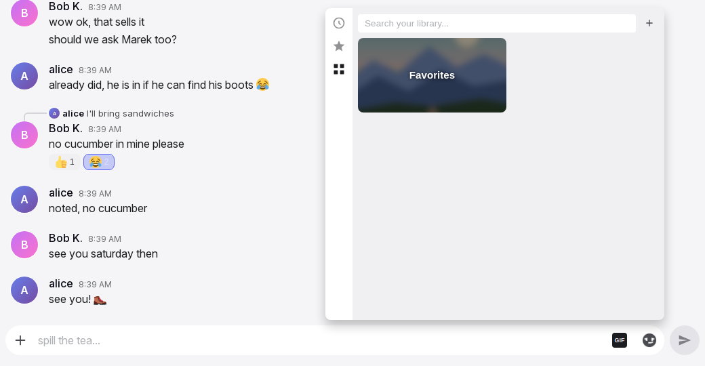

# Emoji and GIF pickers

The emoji picker and the GIF picker open from the input box and put an emoji into the draft or send a GIF. The emoji picker also opens from a message's action bar to add a reaction. On desktop each picker floats above the input box. On a phone both share one bottom sheet with two tabs. Everything inside the pickers answers at once; only GIF search, trending, uploads and sends use the network.

## Anatomy

1. **Category bar.** A 40 px rail on the left of the emoji picker, one icon per section: Recent, each custom pack, then the ten categories. The icon of the section in view is highlighted.
2. **Emoji search.** A field at the top of the grid with a clear button. Results update on every keystroke.
3. **Emoji grid.** Sections with a small capitals header: Recent, the custom packs, then the categories. Cells are 48 px with a 40 px image, 36 px with a 28 px image on a phone.
4. **GIF rail.** A 40 px rail on the left of the GIF picker: Recent, Favorites, Server library, Trending, Browse.
5. **GIF search row.** The field, its clear button, a spinner while the provider searches, and the upload button.
6. **GIF results.** A two-column masonry of cards. A card keeps its GIF's aspect ratio and plays its preview. Library cards carry a favourite star.
7. **Attribution.** A small "Powered by Klipy" badge in a footer strip while provider results are shown.
8. **Phone sheet.** One sheet from the bottom with the tabs "GIFs" and "Emoji", half the screen high, at most 400 px.

## Rules

### Emoji picker

**PK-01** The emoji picker is 460 px wide and at most 450 px high on desktop. It has no title, no close button and no footer. It closes as the [input box](input-box.md#IB-42) describes, on Escape, and when the window crosses the 600 px width.

**PK-02** The sections are, in order: Recent, the custom packs ("Custom" from the server first, then the built-in packs A to Z), then the categories Smileys, Gestures, Animals, Nature, Food, Activities, Travel, Objects, Symbols, Flags. Each section has a header in small capitals.

**PK-03** The category bar has one button per section with the same order: a clock for Recent, the first image of each pack, and one emoji for each category. The button of the section at the top of the view is highlighted and follows the scroll.

**PK-04** A tap on a category button clears the search and scrolls the grid so that the section's header sits directly under the search field. Nothing waits for the server.

**PK-05** Emoji show as images from the same set as in messages, 40 px in a 48 px cell. Each emoji is in exactly one category. There is no skin tone chooser; each cell is one fixed emoji.

**PK-06** The search matches the typed text against each emoji's keywords and each pack emoji's shortcode and pack keywords. Results update on every keystroke, stay grouped under their section headers, Recent first, and sections without a hit disappear. No hit shows "No emojis found". The clear button, a category tap and a reopen all clear the search.

**PK-07** Recent holds the reader's last 20 emoji, newest first, without duplicates. A use is a pick in either picker, a quick reaction, or a tap on a reaction pill. Emoji typed with a keyboard do not count. The list belongs to the account and follows the reader to other devices. Empty, it reads "No recent emojis yet".

**PK-08** The Recent row does not move while the picker is open. It is refreshed on the next open.

**PK-09** Custom packs come from two places: a folder on the server, shown as one section named "Custom", and packs shipped with Yap. A pack emoji is written as ":shortcode:", the file name in lower case. Shortcodes share one namespace; a server emoji with the same name hides the shipped one. An empty pack is not shown.

**PK-10** A pack emoji cell has the tooltip ":shortcode:". Animated pack images animate in the cell.

**PK-11** Cell images load as they come into view, so a closed picker loads nothing. The picker opens at once on the first tap of the session.

**PK-12** On a phone, cells are 36 px with a 28 px image, and the category bar is 36 px wide.

### GIF picker

**PK-13** The GIF picker is 500 px wide and at most 460 px high on desktop. The rail on the left has Recent, Favorites, Server library, Trending and Browse. Server library is hidden while the server has no GIFs. Trending is disabled while no provider is configured.

**PK-14** The first open shows Browse when a provider is configured or the reader has favourites or the server has GIFs; otherwise Recent. The picker keeps its tab and its open folder across close and open; a reopen clears the search and refreshes Recent.

**PK-15** A tap on a tab clears the search and shows that tab with fresh data. A tap on the active tab does nothing.

**PK-16** Recent shows the reader's last 30 GIFs sent from the picker, newest first, without duplicates. A picker upload does not join it. It follows the account. Empty, it reads "No recent GIFs yet".

**PK-17** Trending shows the provider's trending GIFs as a grid, without a header. While they load it reads "Loading…". When they cannot be loaded it reads "Could not load GIFs" and the next open tries again.

**PK-18** Browse shows shortcut tiles first: a "Favorites" tile when the reader has favourites and a tile with the project name when the server has GIFs. Under them, a "Trending" header and the trending grid, or "Could not load GIFs" when trending cannot load. With no provider, no favourites and no server GIFs it reads "Nothing here yet". A tile opens its tab.

**PK-19** Cards form two columns in masonry with 6 px gaps. A card keeps its GIF's aspect ratio and shows a small, muted, looping preview. A preview that cannot start plays on the next tap or key press anywhere.

**PK-20** A tap on a card sends the GIF at once and closes the picker, as the [input box](input-box.md#IB-47) describes. The search text of that moment is remembered with the GIF as a tag, so the next search for it finds it. On a keyboard, a focused card sends on Enter or Space. When the GIF is gone by the time it is sent, the dialog "Couldn't send GIF" says so.

**PK-21** Library cards (Recent, Favorites, Server library, and library hits in a search) have a favourite star at the top right. On desktop it appears on hover; on a phone it is always visible; a favourited star is gold everywhere. A tap on the star changes the favourite only. Provider cards have no star; to keep a provider GIF, the reader sends it, then stars it in Recent or in the message.

**PK-22** Cards show no title, uploader or folder.

### GIF search and the provider

**PK-23** The search field reads "Search Klipy..." with a provider, else "Search your library...". The clear button shows while there is text. A spinner shows while the provider is searched.

**PK-24** The search runs a quarter second after the last keystroke. Library hits show first under "From your library"; provider hits follow under the provider's name. An empty field shows the active tab again. No hits at all reads "No matches".

**PK-25** Library search matches every word of two letters or more against a GIF's tags and shows at most 24 hits. A GIF that misses one word may still show, at most two of them with a provider configured. Hits are ordered by matched words, then the reader's favourites, then server GIFs, then use.

**PK-26** A reader finds server GIFs, provider GIFs that anyone has sent, their own uploads, and GIFs they starred. Other people's uploads stay private until starred.

**PK-27** A GIF's tags come from the search text of each send, the provider's title and tags at a send or a star, the words of an uploaded file's name, and edits in My GIFs or the admin's library, which replace the GIF's tags for everyone.

**PK-28** Provider results come in pages of 30. "Load more" at the end of the list adds the next page, in Trending, Browse and search.

**PK-29** The provider is Klipy. It is configured with a key on the server. Without a key: Trending is disabled, the field searches the library only, there is no provider section and no attribution. The admin's content rating setting applies to search and trending.

**PK-30** While a provider is configured and the field has text, or Trending or Browse is open, a footer strip shows the "Powered by Klipy" badge.

**PK-31** A provider that does not answer gives no provider section and no error; library hits or "No matches" show instead.

### Favourites and the server library

**PK-32** Favorites shows folder tiles first, then an "Unsorted" header when folders exist, then the unfiled favourites. Under the content, a link "Manage your GIFs in Settings". Empty, it reads "⭐ Tap the star on any GIF to save it here".

**PK-33** A folder tile is a 2:1 tile with a blurred, darkened GIF from the folder and the folder name in white. Which GIF is shown may change between visits. A tap opens the folder with a back row "← {folder}"; a tap on the back row returns.

**PK-34** Folders are one level deep, ordered A to Z. They are created and filled in Settings, not in the picker. A star from the picker files the GIF as unsorted. A GIF that is already a favourite keeps its folder when it is uploaded or imported again.

**PK-35** Favourites are ordered by the reader's most recent use, newest first. There is no limit on favourites.

**PK-36** A change made elsewhere (a star in a message, an edit in Settings) shows in an open picker at once. When the open folder is removed, the view returns to the root.

**PK-37** Server library has the same layout as Favorites, without the Settings link, newest GIFs first. Admins fill it from the Admin page; everyone sees and searches it. Empty, it reads "No server GIFs yet".

### Upload from the picker

**PK-38** The upload button in the search row opens the file chooser for one file: .gif, .webp, .mp4, .mov or .webm. A file over 50 MB shows "Couldn't send GIF" with "File is too large (max 50MB)" and the picker stays open.

**PK-39** While the file uploads and is processed, the button becomes a spinner and an overlay with a spinner and "Adding GIF…" covers the results. The search row and the rail stay usable. There is no percentage.

**PK-40** Videos become animated images without sound. A file with the same content as the reader's own earlier upload, or as a server GIF, reuses that GIF. The file name's words become the first tags.

**PK-41** On success the GIF joins the reader's favourites as unsorted, is sent as a message (a reply when the reply bar is open), and the picker closes. The GIF stays private: only the uploader and each person who stars it can find it in search.

**PK-42** On failure the picker stays open behind "Couldn't send GIF" with "Could not process this file as a GIF" when the file was refused, "GIF storage quota exceeded" when the reader's own uploads have reached their quota, or "Upload failed" otherwise. The quota counts the reader's own uploads only; admins are exempt.

### The reaction picker

**PK-43** Add Reaction in a message's action bar opens the emoji picker for that message, with the same sections, search and size. It has no quick reactions; those are in the action bar.

**PK-44** A pick closes the picker and adds or removes that reaction on the message, and moves the emoji to the front of Recent. Position, closing and the row's state while it is open are on the [message row page](message-row.md#MR-42).

### The phone sheet

**PK-45** On a phone (600 px or less) both pickers live in one bottom sheet with the tabs "GIFs" and "Emoji" in that order. Emoji is the active tab on the first open. The sheet is half the screen high, at most 400 px. Each tab fills the sheet and scrolls inside it. The rails are 36 px wide.

**PK-46** A tab switch is instant and keeps each tab's search text, results and scroll position. The active tab is remembered until the page is reloaded.

**PK-47** Neither search field takes focus when the sheet opens. A tap on an emoji cell closes the phone keyboard before the emoji is inserted. A GIF card tap closes the sheet, which closes the keyboard.

**PK-48** The reaction picker on a phone is a sheet of the same size over a dimmed page.

### Without a connection

**PK-49** Without a connection the emoji picker works in full for the draft; a reaction pick needs a connection, as the [message row page](message-row.md#MR-75) says. In the GIF picker, Recent, Favorites, Server library and the Browse tiles show what was last loaded; search, Trending, "Load more", the upload button and the star read "Needs a connection". A tap on a card queues the GIF as a message like any other.

## States

| State or trigger | Input | What the user sees |
| --- | --- | --- |
| Emoji picker opens | mouse, touch | Recent highlighted in the bar, search empty. |
| Scroll the grid | mouse, touch | The highlighted category button follows the section in view. |
| Category tap | mouse, touch | Search cleared, section header right under the search field. |
| Type in emoji search | keyboard | Grouped hits on every keystroke; clear button visible. |
| No emoji hits | keyboard | "No emojis found". |
| Clear button | mouse, touch | Full grid again. |
| Pointer over a cell | mouse | Cell background and a slight enlargement. |
| Cell tap, composer picker | mouse, touch | Emoji into the draft; picker stays open; Recent unchanged until reopen. |
| Cell tap, reaction picker | mouse, touch | Picker closes; reaction toggled. |
| GIF picker opens, first time | mouse | Browse (or Recent) with its data; Trending loading if needed. |
| GIF picker reopens | mouse, touch | Same tab and folder, search cleared, recents refreshed. |
| Tab tap | mouse, touch | Search cleared, tab data refreshed. |
| Type in GIF search | keyboard | After a quarter second: library hits, then provider hits with a spinner meanwhile. |
| Empty GIF field | keyboard | The active tab again. |
| No GIF hits | keyboard | "No matches". |
| Card tap | mouse, touch, keyboard | GIF sent, picker closed; the search text becomes a tag. |
| Pointer over a library card | mouse | Star appears at the top right. |
| Star tap | mouse, touch | Favourite toggled; nothing sent, picker open. |
| Folder tile tap | mouse, touch | Folder view with "← {folder}". |
| Back row tap | mouse, touch | Root view. |
| End of provider results | mouse, touch | "Load more"; the next 30 join the list. |
| Upload button | mouse, touch | File chooser for one GIF or video. |
| Upload running | all | Button spinner, overlay "Adding GIF…". |
| Upload done | all | GIF sent, favourited as unsorted, picker closed. |
| Upload too large or refused | all | "Couldn't send GIF" dialog over the open picker. |
| Trending unavailable | all | "Could not load GIFs". |
| Phone: tab switch | touch | Instant; each tab keeps its state. |
| Phone: emoji cell tap with the keyboard open | touch | Keyboard closes, emoji inserted, sheet stays. |
| No connection, GIF search, Trending, upload or star | all | "Needs a connection"; the lists and the Browse tiles show what was last loaded. |

## Wording

| Where | Text |
| --- | --- |
| Emoji search | placeholder "Search emojis..."; clear button "✕", tooltip "Clear search"; "No emojis found" |
| Emoji sections and bar tooltips | "Recent", "Custom", the pack names ("Wechat"), "Smileys", "Gestures", "Animals", "Nature", "Food", "Activities", "Travel", "Objects", "Symbols", "Flags" |
| Recent empty | "No recent emojis yet" |
| Pack cell tooltip | ":{shortcode}:" |
| GIF rail tooltips | "Recent", "Favorites", "Server library", "Trending", "Browse" |
| GIF search | placeholder "Search Klipy..." or "Search your library..."; clear tooltip "Clear"; spinner tooltip "Searching..."; upload tooltip "Upload a GIF", while busy "Adding GIF…" |
| GIF section headers | "From your library"; the provider name ("Klipy"); "Unsorted"; "Trending" |
| GIF empty and status texts | "No matches"; "No recent GIFs yet"; "⭐ Tap the star on any GIF to save it here"; "No server GIFs yet"; "Loading…"; "Nothing here yet"; "Could not load GIFs"; "Load more" |
| Favorites link | "Manage your GIFs in Settings" |
| Folder navigation | "← {folder}"; tooltips "Back to Favorites", "Back to the server library" |
| Browse tiles | "Favorites"; the project name (default "Yap") |
| Star tooltips | "Add to favorites"; "Remove from favorites" |
| Upload overlay | "Adding GIF…" |
| Attribution | "Powered by Klipy" (alt "Klipy") |
| GIF dialog | "Couldn't send GIF"; "That GIF isn't available anymore — try another one."; "File is too large (max 50MB)"; "Could not process this file as a GIF"; "GIF storage quota exceeded"; "Upload failed"; "Got It" |
| Phone sheet tabs | "GIFs", "Emoji" |
| Reaction picker opener | "Add Reaction" |
| Without a connection | "Needs a connection" |
| Welcome message (configured) | "👋 Hey! Welcome to {0}! We have custom emojis — check them out in the emoji picker 😎" |

## Related

- [Input box](input-box.md) for the toggles, opening and closing, the backdrop, emoji insertion and the GIF send.
- [Message row and actions](message-row.md) for the reaction picker's position and the quick reactions.
- [Settings](settings.md) for managing favourites and folders.
- [Administration](admin.md) for the server library and the content rating.
- [Offline and installation](offline.md) for queued GIF sends.
