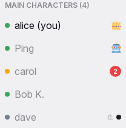

# Presence

Presence is the information that Yap shows about the current state of each person. It shows who is online, away or invisible, when people join and leave, and who types in the open conversation. Presence appears in the people list in the sidebar, in the status chip and the online count in the header, and in the profile card. It also appears in the typing strip above the input box and in the join and leave lines in the lobby. The rules on this page specify what each of these places shows.

## Rules

### Status

**PR-01** An account has one status: online, away or invisible. "Offline" is not a status. It means that the person has no connection. The status belongs to the account. A status pick on one device applies to all devices of the account at once.

**PR-02** The user chooses the status in the status menu. The status of a new account is online. Yap keeps the chosen status until the user changes it. A reload, a new start of the app and a server restart do not change it.

**PR-03** The status colours are fixed. Online is green, away is orange, and invisible and offline are grey. Themes never change these colours.

**PR-04** Away is either chosen or automatic. Other people see the same orange for both. An automatic away does not change the chosen status. During an automatic away, the chip shows orange and the menu still marks "Online". A chosen away ends only with a new pick.

**PR-05** An invisible person appears offline to everyone else. Other people see a grey dot, "Offline" on the profile card, and the person among the offline people. No line appears when the person joins, leaves, turns invisible or turns visible again. The online count does not include the person. The invisible person can still use all of the chat and sees the real status of everyone else. The person's own chip, row and card show the person as grey and "Offline". Admins see "Invisible" on the administration page. When an invisible person types in a conversation, that conversation shows the person as typing.

### Who is online

**PR-06** A person is online while at least one of their devices has Yap open and connected. All tabs and devices of one person show as one entry in the list. The count includes the person once.

**PR-07** The online count is the number of people who are online or away. The count includes the bot. The count does not include invisible people, also not in their own view. For everyone else, the count in their own view includes themselves.

**PR-08** Presence changes show to everyone at once, within a second. A person who joins appears in every open list. A person who leaves disappears from every open list. A person who changes status changes colour in every open list.

**PR-09** The bot is always online.

### Automatic away

**PR-10** A person becomes away after 5 minutes without input on any of their devices. Input is a key press, a tap, a pointer move, a wheel movement or a return to the tab. Incoming messages are not input. Other people see the change within 10 seconds after the 5 minutes. When every tab of the person is hidden, the change can show up to a minute later.

**PR-11** A hidden tab alone does not make a person away. The rule of 5 minutes without input applies. A person who watches a video for 5 minutes without input shows as away. Both behaviours are accepted.

**PR-12** Automatic away applies only when the chosen status is online. A chosen away or a chosen invisible never changes automatically.

**PR-13** Any input on any device ends an automatic away within 10 seconds. A return to the tab or a pick in the status menu ends it at once.

### Leaving

**PR-14** When a person closes the last tab or signs out of the last device, the person shows as offline 30 seconds later, without an away phase. A return within that time shows nothing. The person leaves the list, or turns grey when the person shares a direct message with the viewer. "Sign out all other devices" has the same effect for the other devices. The leave line follows PR-17.

**PR-15** When a connection drops and the tab stays open, the person shows as away after 30 seconds. Examples are a network loss, a phone that sleeps and a closed laptop. When another device of the person is visible, with or without input, the change does not occur. Thus a locked phone does not turn a person orange while the person uses a desktop.

**PR-16** When all connections of a person are gone for 5 minutes, the person shows as offline. The person leaves the list, or turns grey as a direct message partner. A connection that returns within the 5 minutes keeps the chosen status. Yap announces nothing.

**PR-17** A join is the first connection of a person. A leave is the moment when the person shows as offline. This is 30 seconds after the person closes the last tab or signs out, or 5 minutes after the last connection drops. A return before that moment cancels the leave. Thus a reload shows nothing. The lobby shows a join or leave line to the people who have the lobby open at that moment. The [message row page](message-row.md#MR-73) gives the line texts.

**PR-18** When a new account joins for the first time, the bot sends a direct message to the admin: "👋 {display name} just joined the chat!".

### Typing

**PR-19** "X is typing" shows only in the typing strip of the open conversation, to the people who have that conversation open. It never appears in the sidebar, the header, the tab title or a notification. In a direct message, only the other person sees it.

**PR-20** The indicator appears within about a second after the first keystroke. It disappears 3 seconds after the last keystroke. It disappears at once on send, when the draft becomes blank, when the typist leaves the conversation, and when the typist's tab becomes hidden. A dropped connection ends it like a last keystroke.

**PR-21** When several people type, Yap shows one of the configured texts for two, or for three or more. The display names are in the order in which the people started to type. Yap first leaves out the viewer and then chooses the text for the people who remain. The text changes only when the set of typists changes.

**PR-22** Typing also shows in a read-only room, because people with permission can write there. An edit of a message does not count as typing.

### What presence is not

**PR-23** Other people see no last-seen time. The card of an offline person shows "Offline". Admins see last-action times on the administration page.

**PR-24** Status has no effect on delivery, sending, reactions or access. Away has no automatic reply. A visible session of an online person suppresses notifications to the other devices of that person. Away (chosen or automatic) and invisible do not suppress them. As a result, an idle desktop never suppresses the notifications on the phone. Away also stops the automatic read in the open conversation. See [Notifications and unread](notifications.md).

**PR-25** The device type of a person shows only to that person, in Settings, and to admins. Other people never see it.

## States

| State or trigger | Input | What the user sees |
| --- | --- | --- |
| Status pick | mouse, touch | Chip and own dot change at once on every device; the menu marks the pick. |
| 5 min without input on every device | all | Others see orange; the own chip turns orange; the menu still marks Online. |
| Any input while automatically away | keyboard, mouse, touch | Green again within 10 seconds; at once on tab return. |
| Chosen Away, input | all | Stays orange. |
| Invisible | all | Grey to others and to themselves, "Offline" on the card, not counted. |
| Second device joins | all | Same status everywhere; the count does not change. |
| Last tab closed or sign out | all | Gone from the list, or grey as a direct message partner; leave line after 30 s unless the person returns. |
| Connection drops, tab open | all | Orange after 30 s unless another device is visible; offline and the leave line after 5 min. |
| Connection returns within 5 min | all | Chosen status again; no join line. |
| First keystroke in a conversation | keyboard, touch | Others in it see the typing text within a second. |
| 3 s without typing, send, empty draft, leave, hidden tab | all | Typing text gone. |
| Two or more typing | all | The viewer is left out first; the text matches the people who remain. |
| New account's first join | all | Join line in the lobby; bot message to the admin. |

## Wording

| Where | Text |
| --- | --- |
| Status menu | "Online"; "Away"; "Invisible" |
| Profile card status | "Online"; "Away"; "Offline" |
| People section title (configured; defaults) | "the gang ({0})", "squad check ({0})", "main characters ({0})", "{0} legends present", "chat fam ({0})"; fallback "Online Users ({0})" |
| Typing, direct message | "{name} is typing..." |
| Typing, room (configured lists for one, two, three or more) | see the [input box page](input-box.md#wording) |
| Bot to the admin | "👋 {display name} just joined the chat!" |
| Settings, sessions | "Active Sessions"; "This device"; "Active {time}" with "just now", "{n}s ago", "{n}m ago", "{n}h ago", "{n}d ago" |
| Administration, status pills | "Online"; "Away"; "Invisible"; "Offline" |

## Related

- [Header, sidebar and overlays](frame.md) for the chip, the menu, the count and the people list.
- [Input box](input-box.md) for the typing strip and what starts typing.
- [Message row and actions](message-row.md) for the lobby join and leave lines.
- [Notifications and unread](notifications.md) for what a visible session suppresses.
- [Settings](settings.md) for the list of the user's own sessions.
- [Administration](admin.md) for the sessions table admins see.
