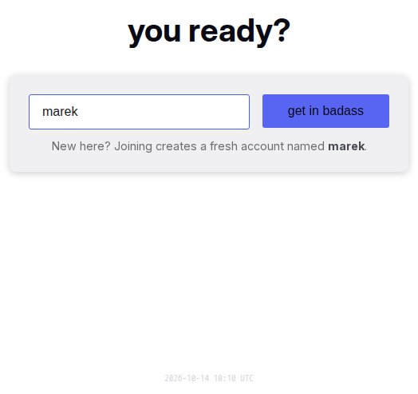

# Sign-in and sessions

Sign-in gives a device access to an account. An account needs only a username, with no password and no e-mail address. A device that signed in once stays signed in. A new device signs in with a login link, through the network that it shares with a signed-in device, or with a short code. This page specifies how accounts are created and every way to sign in. It also specifies what a session is, how a session ends, and how the installed app signs in.

## Rules

### Accounts

**AU-01** An account has a username and an optional display name, avatar, bio and location. The person chooses the username once, and the username never changes. Sign-in always uses the username and never the display name.

**AU-02** A username has 2 to 23 characters. It can contain lowercase letters, digits, "_" and ".", but not two periods in a row. The login box lowercases and trims the text as the user types. It shows the rule that fails.

**AU-03** The bot's username is reserved. Yap refuses a new username that equals the display name of a member, and shows an explanation. *Why:* members typed their display name on the login page and created a second account without noticing it.

**AU-04** The first human account on a server is the admin. The bot is never the admin. The app has no function to rename an account, move the admin role or delete an account.

**AU-05** The admin can close registration and can require approval. When both are on, closed registration applies. When registration is closed, the login page keeps its form for existing users and tells a person with a new name that registration is closed. When approval is required, a person with a new name waits on the login page while the admin gets a message. Approval signs the person in. Rejection lets the person try another name. Invites bypass both settings.

**AU-06** When the server runs without persistence, accounts exist until the server restarts. After a restart, every device shows the login page and the usernames are free again. The first person who signs up becomes the admin. This behaviour is an intended product mode.

### Ways in

**AU-07** The login page has one box for the username and one button. The heading, the button text and the placeholder are playful texts from the configured lists. For a free name, the page shows the hint "New here? Joining creates a fresh account named {name}." and the button creates the account.

**AU-08** Yap checks an existing username in this order. If smart login applies, it signs the device in at once. Otherwise, if the account has a login link or a secret code, the verification page asks for a code. Otherwise, the page explains how to transfer the login from a signed-in device.

**AU-09** Smart login signs a device in with the username alone. It applies when the account has a connected device on exactly the same network address now. It also applies when the account had a connected device on that address within the last 14 days. Yap remembers up to five addresses. Smart login does not work on networks that change the address for each connection. It is on by default for the server and for every account. The admin can turn it off for everyone, and a person can turn it off for their own account. The other devices of the account get a message about the new sign-in.

**AU-10** A login link is a URL with a readable code, for example "blue-fox-4821". When a person opens the link on any device, the page shows "Welcome back, {username}" and one button. The button signs the device in. Opening the link alone never signs the device in. *Why:* messengers and link previews fetch pasted URLs.

**AU-11** Every account gets a login link when the account is created. The link never expires, except for an account made from an invite, which keeps the expiry of the invite. The bot's welcome message contains the link. In Settings, the person can reveal, copy, replace and revoke the link. The person can also set its expiry to 1, 7 or 30 days or to never. Only one link is active at a time, and a new link revokes the old one.

**AU-12** The code of the link also works as a typed code on the verification page. It works in any letter case and with any separators. It works only for its own username.

**AU-13** A secret code is a retired way to sign in. It is a passphrase that the server made, for example "blue fox 42". An account that already has a code keeps it. In Settings, such a person can view, copy, replace or disable it. Nothing creates a new code, and a disabled code cannot come back. The login link does this job: a person who sees the link but cannot open it types the username and the code of the link instead (AU-12). A code and a link can exist together.

**AU-14** The verification page accepts the secret code or the code of the login link. The secret code must match exactly, including letter case. The code of the link accepts any letter case and any separators. For a wrong code, the page says that the code is wrong. After 20 wrong codes within 10 minutes, every code sign-in pauses for 10 minutes and the admin gets a message. The count includes wrong codes from any person and opened dead links. There are no other lockouts.

**AU-15** A link shows the address that the viewer used to reach Yap. Thus links contain the address that people actually use, and nobody can insert a different address. The server configuration can set one public address for everyone.

### Invites

**AU-16** Only the admin creates invites, with a private note and an expiry. The invited person picks a username and joins. Yap creates the account even when registration is closed. The invite then becomes the login link of that person.

**AU-17** When two people use one invite, the invite serves the first person. The second person also gets an account, with a separate login link. An unknown, expired or revoked link shows "This link no longer works" and offers the login page.

### Sessions

**AU-18** A device is one browser profile or one installed app. A signed-in device stays signed in for one year after its last visit. Every visit extends this period. Yap never asks the person to sign in again on a device that the person uses.

**AU-19** Settings lists the connected devices of the account. Each row shows a phone or desktop icon, the network address and "Active {time}". The row of the current device also shows "This device". The current device is always in the list. The list has one row per device, and several tabs on one device share one row. A device that loses its connection leaves the list after 5 minutes.

**AU-20** "Sign out all other devices" is always available, because a device can be signed in without a connection. A device that the server first saw less than one hour ago cannot use it. The button is disabled with the text "Available {n} min after this device signed in. The devices that were signed in before can use it now." The server refuses the request as well. *Why:* the bot's message about a new sign-in reaches the new device too, and a person who got in through smart login on a shared network must not sign the owner out. It ends the sign-in of every other device at once and removes their notification subscriptions. It replaces the secret code when one exists. It forgets the remembered networks and cancels the automatic first-launch sign-in of the installed app. Other tabs on this device stay signed in. Login links stay valid, so a leaked link needs Revoke. A signed-out device on the same network can still sign in again through smart login, unless the person turns smart login off. The person sees "All other devices have been signed out." and the new code, when one exists.

**AU-21** A device that is signed out from elsewhere shows the login page as soon as it is connected. Without a connection, the device keeps the cached conversations readable. When the connection returns, the device receives the sign-out. It then removes the local data of the account and shows the login page with the notice "This device was signed out from elsewhere. Sign in again to continue." The notice stays until the next sign-in on this device; a reload clears it.

**AU-22** Sign Out ends the sign-in of this device only. The device then shows the login page. When the account has no link and no code, a confirmation says what is left: smart login for 14 days when it is on ([AU-09](sessions.md#AU-09)), and a new link from an admin ([AD-06](admin.md#AD-06)); the only admin has nobody to ask. The texts are in [SH-15](frame.md#SH-15). When unsent messages exist, a confirmation warns that they are lost. A sign-out removes every draft, pending message, cached conversation and notification subscription of the account from the device. In the browser that signed out, it also ends the automatic first-launch sign-in of an app installed from it ([AU-23](sessions.md#AU-23)). An app that already has its own cookies, as on iOS, is not reached.

### The installed app

**AU-23** An app that is installed from a signed-in browser signs in automatically on its first launch, within 72 hours after the install. After that, the app has its own session.

**AU-24** An app that still starts signed out shows the login page. When the typed name cannot sign in automatically and has neither a link nor a code, the page shows the guide for the installed app. The guide tells the person to open Yap in the browser, copy the login link, and open it in the app or type its code.

**AU-25** When a different account signs in on a device, the new account starts with no local data on the device. Yap first removes the drafts, pending messages and cached conversations of the previous account.

### Messages the bot sends

**AU-26** One minute after a person's first session, the bot sends the welcome message with the login link and, on a phone, the install line. On every sign-in of a new device, the bot tells the account which sign-in method was used and from which address. The message advises the person to use "Sign out all other devices" if the person did not make this sign-in. The new device cannot use it for one hour. The admin gets a message for a pending request, for the first join of a new account, and for the sign-in pause.

## States

| State or trigger | Input | What the user sees |
| --- | --- | --- |
| Free name typed | keyboard | Hint "New here? …"; the button creates the account and opens the link the person came for, else the lobby. |
| Name too short, bad characters, bot's name, a member's display name | keyboard | The matching error under the box; button disabled. |
| Existing name, same network as a signed-in device | all | Signed in at once; the other devices get the bot's message. |
| Existing name, account has a link or code | all | Verification page "Welcome back, {username}". |
| Existing name, no link, no code, no match | all | The guide with three steps and "Done, try again". |
| Right code | keyboard | Signed in; bot message to the account. |
| Wrong code | keyboard | "Wrong code". |
| 20 wrong codes in 10 min, anyone | all | For 10 min, the verification page says "Too many attempts. Try again in a few minutes." and a link page says "One moment"; admin message. |
| Registration closed, new name | keyboard | "Registration is temporarily closed" with its text; existing names still work. |
| Approval required, new name | keyboard | "Waiting for approval"; signed in on approval; "Try again" on rejection. |
| Login link opened, signed out | touch, mouse | "Welcome back, {username}", "Continue as {username}". |
| Login link opened, signed in as the owner | touch, mouse | The lobby opens directly. |
| Login link opened, signed in as someone else | touch, mouse | "Switch account?" with "Switch to {owner}" and "Stay as {current}". |
| Invite opened | touch, mouse | "You're invited to {Project}", a username box, "Join". |
| Expired or revoked link | all | "This link no longer works" with "Go to the login page", or "Back to chat" when signed in. |
| Settings, New Link | mouse, touch | New link revealed; "New link created. The old one no longer works." |
| Settings, Revoke | mouse, touch | "Login link revoked"; "Create Login Link" appears. |
| Settings, expiry picked | mouse, touch | "Link expires {date}" or "Link never expires". |
| Sign out all other devices | mouse, touch | Other devices show the login page with the signed-out notice; this device shows "All other devices have been signed out." |
| Sign Out, no link and no code | mouse, touch | Confirmation about losing the account. |
| Sign Out, unsent messages | mouse, touch | Confirmation about losing them. |
| Installed app, first launch | touch | Signed in with no action from the person. |
| Installed app, starts signed out | touch | The login page; the installed-app guide for a name with no other way in. |

## Wording

| Where | Text |
| --- | --- |
| Login heading (configured; defaults) | "welcome to {0}", "you ready?", "you found {0}", "{0}"; fallback "Welcome to {0}!" |
| Join button (configured; defaults) | "lessgo", "slide in", "hop on", "lock in", "get in queen", "join the squad", "get in badass"; fallback "Join Chat" |
| Username placeholder (configured; defaults) | "drop your @", "who dis?", "username goes here", "tag yourself"; fallback "Enter your username" |
| Login errors | "Username must be at least 2 characters"; "Username must be at most 23 characters"; "Only lowercase letters, numbers, _ and . allowed"; "Cannot have consecutive periods"; "Nice try! 🤖"; "\"{name}\" is a member's display name. If that's you, log in with your original username — changing your display name never changes your login. Otherwise, pick a different name."; "This username is already waiting for approval" |
| Login hint | "New here? Joining creates a fresh account named {name}." |
| Guide, browser | "Almost there!"; "To log in as {name} on this device:"; "Open the app on the device where you're already logged in"; "In Settings → Login Link, copy your link (create one if there isn't one), or just read its code"; "Open the link on this device, or come back here and type the code"; "Done, try again" |
| Guide, installed app | "Almost there!"; "This installed app starts signed out — your login for {name} stayed in the browser you joined from."; "Open {Project} in your browser — you should still be logged in there"; "In Settings → Login Link, copy your link (create one if there isn't one), or just read its code"; "Open the link here, or come back and type the code"; "Done, try again" |
| Registration closed | "Registration is temporarily closed"; "New signups are not being accepted right now. Please check back later." |
| Approval | "Waiting for approval"; "Your request to join as {name} has been submitted."; "An admin will review your request shortly. This page will update automatically."; "Your previous request was not approved. You can try a different username."; "Try again" |
| Verification page | tab title "Verify — {username}"; "Welcome back, {username}"; "Type the code from your login link (the part after /invite/). An older secret code works too."; placeholder "e.g. blue fox 4821"; "Sign In"; "Use a different username"; "Wrong code"; "Too many attempts. Try again in a few minutes." |
| Link page | "You're invited to {Project}"; "Pick a username to join."; placeholder "username"; "Join"; "Joining…"; "Welcome back, {username}"; "This link signs you in as {username} on this device."; "Continue as {username}"; "Signing in…"; "Switch account?"; "You are signed in as {current}. This link belongs to {owner}."; "Switch to {owner}"; "Switching…"; "Stay as {current}"; "This link no longer works"; "It may have expired or been revoked. Ask the person who sent it for a new one."; "Back to chat"; "Go to the login page"; "One moment"; "Too many sign-in attempts right now. Try this link again in a few minutes." |
| Link page errors | "That username is already taken"; "A member already goes by that name. Pick a different one."; "That username is already taken. Pick another one."; "That username is not allowed. Pick another one." |
| Settings, Login Link | "Login Link"; "This account is tied to this device only."; "You can log in from other devices with {ways}." with "your login link", "your secret code", "smart login from a network you used recently"; "Open this link on any device or browser to sign in as {username}. Anyone who has it can sign in, so keep it private. Can't open the link but can see it? On the login page, type your username, then type the last part of the link (the words after /invite/) as your code. Letter case and dashes don't matter."; "Create a link that signs you in on any device or browser. Save it somewhere safe, like your notes. It's the way back into this account: open it, or type its code on the login page."; "Reveal"; "Hide"; "Copy"; "Copied!"; "New Link"; "Revoke"; "Create Login Link"; "Never expires"; "Expires in 1 day"; "Expires in 7 days"; "Expires in 30 days"; "Expires {date}"; "Login link created"; "New link created. The old one no longer works."; "Login link revoked"; "Link never expires"; "Link expires {date}"; "Allow smart login"; "Log in without a code from a network you've used recently." |
| Settings, Secret Code | "Secret Code"; "An older way to log in as {username}: type this code with your username on the login page. Your login link does the same job. If you disable the code, it cannot be turned on again."; "New Code"; "Disable"; "Disable your secret code? It cannot be turned on again."; "Secret code changed"; "Secret code disabled" |
| Settings, sessions | "Active Sessions"; "This device"; "Unknown IP"; "Active {time}" with "just now", "{n}s ago", "{n}m ago", "{n}h ago", "{n}d ago"; "Sign out all other devices"; "Signing out..."; "Other devices signed out"; "Failed"; "All other devices have been signed out."; "Your login link keeps working."; "Your secret code was automatically changed. See the new one below." |
| Bot, welcome | the three parts the admin edits (admin.md, AD-09); by default the welcome "👋 Hey! Welcome to {server}! We have custom emojis — check them out in the emoji picker 😎"; "📱 I noticed you're on a phone. It's a much better experience if you install it to your homescreen — it will look and feel like a normal app. Please also allow notifications when prompted so you don't miss messages. You can change this anytime in Settings."; "🔗 One more thing — this is your personal login link: {url}"; "Open it on any device or browser and you're straight back in this account (new phone, reinstalled app, second browser). Save it somewhere safe, like your notes. Don't share it — anyone who has it can sign in as you. On the login page you can also type its code, {code}, as your secret code. You can manage the link anytime in Settings." |
| Bot, new device | "🔐 New device sign-in detected for your account using **{method}** from IP `{ip}`. If this wasn't you, open **Settings** and use **Sign out all other devices** immediately." with "smart login (same network)", "your login link" or "secret code" |
| Bot, rescue link | "🔗 An admin created a new login link for you: {url}"; "Your previous link no longer works. Save this one somewhere safe." |
| Bot, to the admin | "👋 **{username}** is requesting to join. Go to the Admin panel to approve or reject."; "👋 {display name} just joined the chat!"; "🚨 {n} failed login-link attempts in the last few minutes. Code sign-ins are paused for 10 minutes. Someone may be guessing codes — check the Visitors tab in Admin for failed sign-ins." |

## Related

- [Header, sidebar and overlays](frame.md) for Sign Out in the status menu and the logged-out redirect.
- [Offline and installation](offline.md) for the installed app and what the device keeps.
- [Settings](settings.md) for the Login Link, Secret Code and Active Sessions sections.
- [Administration](admin.md) for invites, registration switches and the rescue link.
- [Presence](presence.md) for what a connected device means.
