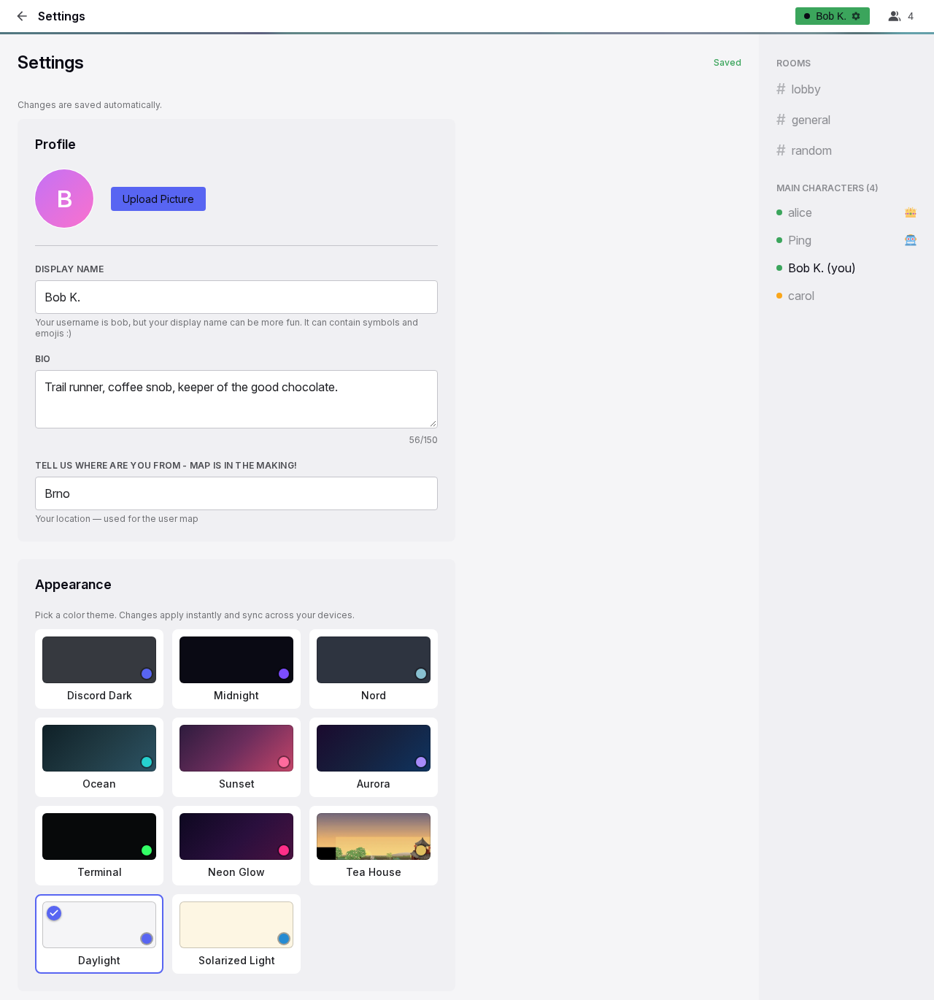

# Settings

Settings is the one page where a person shapes their own Yap: profile, look, ways back into the account, devices, notifications, time format and their GIF library. It opens from the status menu and from a few links in the app. Every change saves by itself; there is no Save button anywhere on the page.

## Anatomy

1. **Frame.** The same header and sidebar as a conversation. The title area shows a back arrow and "Settings".
2. **Page heading.** "Settings" with a chip on the right that reads "Saving..." then "Saved" for profile changes, and the line "Changes are saved automatically."
3. **Cards.** One column of cards, at most 600 px wide, in this order: Profile, Appearance, Text Size, Login Link, Secret Code, Active Sessions, Install as App, Device Push Notifications, Allow / Mute Notifications, Time & Date, My GIFs, and a collapsed DEBUG INFO card at the end.
4. **Notice.** After "Sign out all other devices", an amber notice above the heading with a close control.

## Rules

### Page

**ST-01** Settings opens from "Settings" and "Notification settings" in the status menu, from "Manage your GIFs in Settings" in the GIF picker, and from links in the bot's messages. "Notification settings" and the picker link scroll to their sections.

**ST-02** Every control saves at once on change. Profile text saves after a short pause in typing and when the user leaves the page, so nothing typed is lost. A failed save says so next to the control.

**ST-03** The page keeps the live connection: the sidebar and header keep updating while the user is here.

### Profile

**ST-04** The avatar shows at 80 px with "Upload Picture" or "Change Picture" and, when a picture exists, "Remove". A picture is any image up to 10 MB; the server crops it to a square. A rejected file says "Choose an image up to 10 MB". Remove needs no confirmation.

**ST-05** Display Name holds up to 64 characters, with the username as its placeholder and the hint that it can contain symbols and emoji. Empty means the username is shown.

**ST-06** Bio holds up to 150 characters with a live counter. Location holds up to 100 characters, with "Detect" when the server can tell the country from the address.

**ST-07** A profile change shows at once in the user's own header and on their messages, and on other people's screens at once.

### Appearance and text size

**ST-08** Appearance shows a grid of theme cards, each with a preview, an accent dot and the name; the chosen one has a check badge. The themes are Discord Dark (the default), Midnight, Nord, Ocean, Sunset, Aurora, Terminal, Neon Glow, Tea House, Daylight and Solarized Light. A tap repaints the whole app at once and saves. A theme that no longer exists falls back to the default.

**ST-09** Tea House changes its picture with the time of day, every two hours, on its own.

**ST-10** Text Size has six presets, 14, 15, 16 (Default), 17, 18 and 20 px, each shown as "Aa" at its size. A tap rescales all text at once and saves. The theme and the text size follow the account to other devices on their next load.

### Ways back in

**ST-11** Login Link opens with one line that sums up the ways back into the account: "This account is tied to this device only.", or the ways the person has, in the order login link, secret code, smart login.

**ST-12** With a link: the hint, the URL with its code masked, Reveal and Copy, then "New Link", "Revoke" and the expiry choice. Without a link: the hint and "Create Login Link". The rules are on the [sign-in page](sessions.md#AU-11).

**ST-13** "Allow smart login" is a switch under the link, shown only while the admin allows smart login. It is on by default.

**ST-14** Secret Code sits below Login Link on purpose. With a code: the masked code, Reveal and Copy, "New Code" and "Disable". Without: the hint and "Enable Secret Code". Status lines show for 3 seconds.

### Devices

**ST-15** Active Sessions lists the account's connected devices with a phone or desktop icon, "This device" on the current one, the network address and "Active {time}". The current device is always listed. "Sign out all other devices" shows when another device is signed in and acts without a confirmation; the page then shows the notice "All other devices have been signed out." with the new secret code when one exists.

**ST-16** Install as App shows "Install Yap" with its explanation, or "Yap is installed as an app on this device." inside the installed app. See [Offline and installation](offline.md).

### Notifications

**ST-17** Device Push Notifications shows the state of this device, the browser permission, the count of subscribed devices, and the device list with "Remove" on each. One action fits the state: enable on this device, turn off on this device, or the reason why neither is possible. "Send a test to all devices" shows when there are devices.

**ST-18** Allow / Mute Notifications has the server-wide "Allow" or "Mute" with a duration, then the "Direct messages" and "Rooms" rows with "Allow all", "Individual" and "Mute all", each Individual mode listing its conversations with a bell. The rules are on the [notifications page](notifications.md#NT-16). The mute hint reads "Muted for another {time}." with a proper singular and counts down while the page is open.

### Time & Date

**ST-19** "Your time" shows the current time in the user's time zone with "−", "+" and "Detect". The zone and the language were detected at sign-up and stay until changed here; "−" and "+" shift the zone by an hour, "Detect" takes the browser's zone.

**ST-20** Clock offers 24-hour and 12-hour; Date order offers day-month-year, month-day-year and year-month-day; Separators appears when the browser language and the zone's country format differently. Each is a row of cards that show today's date and time in that form, and each works with the keyboard. The choices apply to every time in the app.

### My GIFs

**ST-21** My GIFs is the user's pool: everything starred plus their own uploads, in folders. The toolbar has folder chips ("All", "Unsorted", one per folder), a filter field from nine GIFs on, "＋ Add GIFs", "Import zip" and "Export". A quota bar shows "{used} of {quota} used" for the user's own uploads; starred GIFs are free.

**ST-22** Add takes several .gif, .webp or short video files at once, up to 50 MB each, into the open folder, with a progress line and one error line per refused file. Import takes one zip up to 1 GB whose subfolders become folders and whose manifest adds tags. Export downloads the pool as a zip that imports back without loss.

**ST-23** A card shows the preview, up to four tag chips and the folder choice. Tags are edited in place and belong to the GIF, so a change affects search for everyone who can see it. A new folder is created from the folder choice; a folder disappears when its last GIF leaves it.

**ST-24** "Delete" on an own upload asks "Sure?" before it deletes the file; a file still used in chat or by others is removed from the pool instead. "✕" unstars at once. Six cards show first, then 24 more per tap.

### Debug

**ST-25** DEBUG INFO is a collapsed card with what the browser keeps for Yap on this device: cached files by group and their size, the storage estimate, and "Clear this cache" for the media cache. Clearing keeps drafts and unsent messages.

## States

| State or trigger | Input | What the user sees |
| --- | --- | --- |
| Typing in a profile field | keyboard | "Saving..." then "Saved" for 2 s. |
| Leaving the page right after typing | all | The edit is saved. |
| Picture chosen | mouse, touch | Avatar updates; "Saved". A bad file: "Choose an image up to 10 MB". |
| Theme tap | mouse, touch | Whole app repainted at once. |
| Text size tap | mouse, touch | All text rescaled at once. |
| New Link, Revoke, expiry | mouse, touch | Link shown or removed; green status for 3 s. |
| New Code, Disable, Enable Secret Code | mouse, touch | Code shown or removed; green status for 3 s. |
| Sign out all other devices | mouse, touch | Other devices signed out; amber notice; code revealed. |
| Enable push | mouse, touch | Browser asks; "Subscribed"; device row appears. |
| Send a test | mouse, touch | Every device buzzes; result line for 3 s. |
| Mute with a duration | mouse, touch | Conversation rows hidden; "Muted for another {time}." |
| Individual mode | mouse, touch | A bell per conversation under the row. |
| − or + on the time | mouse, touch, keyboard | The shown time shifts by an hour; saved. |
| Date order or clock card | mouse, touch, keyboard | Times across the app change. |
| Add GIFs | mouse, touch | Progress line; cards appear; errors in a red strip. |
| Tag chip tap | mouse, touch | Inline tag input; Enter saves, Escape cancels. |
| Delete own upload | mouse, touch | "Sure?" then gone, or removed from the pool with a note. |

## Wording

| Where | Text |
| --- | --- |
| Page | "Settings"; "Changes are saved automatically."; "Saving..."; "Saved" |
| Notice | "All other devices have been signed out."; "Your login link keeps working."; "Your secret code was automatically changed. See the new one below." |
| Profile | "Profile"; "Upload Picture"; "Change Picture"; "Uploading..."; "Remove"; "Choose an image up to 10 MB"; "Display Name"; "Your username is {username}, but your display name can be more fun. It can contain symbols and emojis :) "; "Bio"; "Why are you awesome..."; "{n}/150"; "Location"; "London"; "Detect" |
| Appearance | "Appearance"; "Pick a color theme. Changes apply instantly and sync across your devices."; "Discord Dark"; "Midnight"; "Nord"; "Ocean"; "Sunset"; "Aurora"; "Terminal"; "Neon Glow"; "Tea House"; "Daylight"; "Solarized Light" |
| Text Size | "Text Size"; "Scales all text in the app. Applies instantly and syncs across your devices."; "Aa"; "14px"; "15px"; "Default"; "17px"; "18px"; "20px" |
| Login Link, Secret Code, Active Sessions | see the [sign-in page](sessions.md#wording) |
| Install | "Install as App"; "Install Yap to your home screen for a full-screen experience with push notifications and quick access."; "Install Yap"; "Yap is installed as an app on this device." |
| Push and mutes | see the [notifications page](notifications.md#wording); mute time "1 minute", "{n} minutes", "1 hour", "{n} hours", "1 day", "{n} days", "a moment" |
| Time & Date | "Time & Date"; "Your time"; "−"; "+"; "−1 hour"; "+1 hour"; "Detect"; "Adjust if the time doesn't match your clock"; "Clock"; "Date order"; "Separators"; "Detected: {time zone} · {locale}" |
| My GIFs | "My GIFs"; "Your GIF pool — everything you've starred plus your own uploads. Organize with folders, edit search keywords, or bring a whole collection: import files or a zip, and export everything as a zip you can take anywhere."; "All"; "Unsorted"; "Filter by keyword…"; "＋ Add GIFs"; "Uploading…"; "Import zip"; "Export"; "{used} of {quota} used"; "Only your own uploads count — starred GIFs are free"; "Uploading… {p}% ({done} of {total})"; "Importing… {done} of {total}"; "Imported {done} of {total}"; "processing…"; "add keywords…"; "+{n}"; "comma, separated, tags"; "(unsorted)"; "＋ New folder…"; "folder name"; "Delete"; "Sure?"; "Still used in chat or by others — removed from your library instead."; "You can only delete your own uploads."; "Nothing here yet — star GIFs in the picker, or add your collection above."; "No GIFs match your filter."; "Nothing in this folder."; "Show 24 more ({n} left)"; "Show {n} more"; "Show less"; "ffmpeg not detected — video conversion is off, only .gif/.webp files can be imported." |
| My GIFs errors | "\"{name}\" — unsupported file type"; "\"{name}\" — too large ({n} MB, max {m} MB)"; "\"{name}\" — server processing timeout"; "\"{name}\" — upload failed"; "GIF storage quota exceeded"; "Could not process this file as a GIF"; "Upload failed — something went wrong."; "GIF storage quota exceeded — import stopped"; "import failed — the zip could not be read" |
| Debug | "DEBUG INFO"; "Cached files"; "{n} file(s) · {size}"; "Origin storage estimate"; "{used} of {quota}"; "Empty"; "Clear this cache"; "Clearing a cache keeps your locally saved drafts and outgoing messages." |

## Related

- [Sign-in and sessions](sessions.md) for the link, the code and the devices.
- [Notifications and unread](notifications.md) for the two notification sections.
- [Emoji and GIF pickers](pickers.md) for where the GIF pool is used.
- [Message row and actions](message-row.md) for how times are shown.
- [Offline and installation](offline.md) for the install section.
- [Header, sidebar and overlays](frame.md) for the frame around the page.
