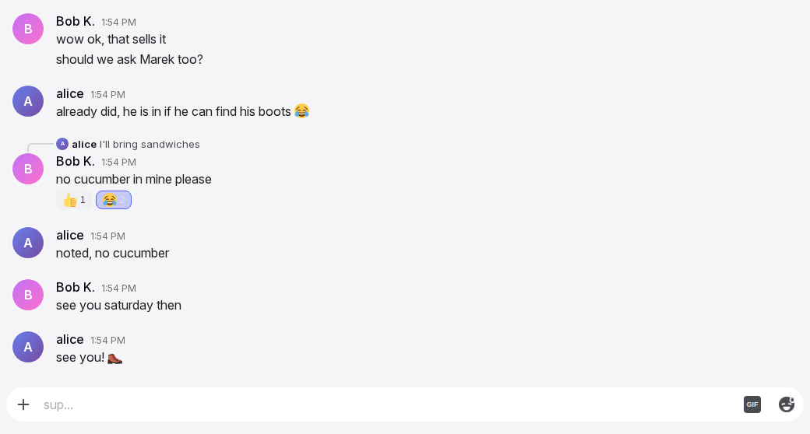
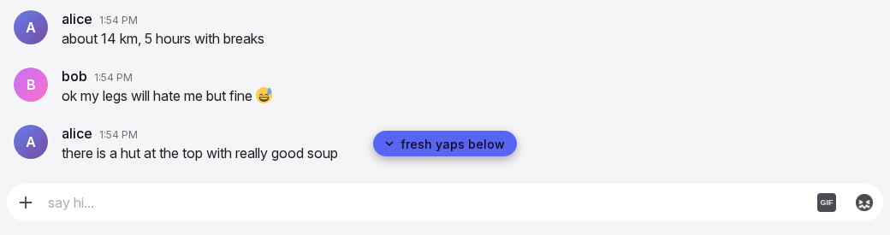
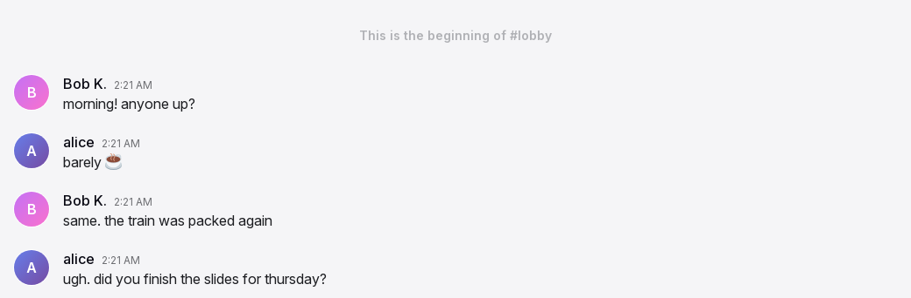
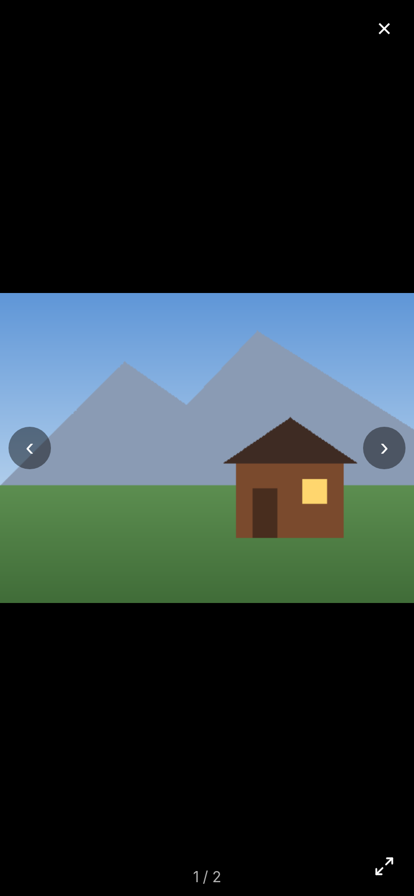

# Timeline and media

The timeline is the scrolling list of messages in a conversation. The oldest loaded message is at the top and the newest message is at the bottom. The timeline controls which messages load and the position of the view. It controls when the view follows new messages, when it stays in position, and how the user gets to older messages. The timeline also includes the gallery viewer, which opens from an image. The [message row page](message-row.md) specifies the rows.

## Anatomy

1. **The list.** The list fills the conversation column above the input box and scrolls vertically. A short conversation shows at the bottom, with empty space above it.
2. **The top note.** A note that shows only when all history is loaded. It is the room description, the "beginning" note, or the restricted-history note. While older messages exist, nothing shows above the first row. The exceptions are the "Load earlier messages" link in a conversation too short to scroll, and "Needs a connection" without a connection. There are no date separators and no unread divider.
3. **The loading pill.** A small "Loading older messages..." pill with a spinner. It floats over the top of the list while a page loads or waits for a still view. It takes no space of its own, so no row moves when it comes or goes, and a fast answer never shows it (the 400 ms rule of TL-02).
4. **New messages pill.** A rounded pill in the accent colour, with a down chevron. It shows centred above the typing strip when messages arrive while the user reads older messages.
5. **Pending rows.** Rows for the user's own messages that the server did not accept yet. They are at the end of the list.
6. **Gallery viewer.** A full-screen layer over the whole app, which opens from an image. It shows the picture, the previous and next controls, the download, fill and close controls, and a counter.
7. **Down arrow.** A small round button with a down arrow, in the bottom right corner above the typing strip. It shows when the view is more than one screen above the bottom and the pill is not shown.

## Rules

### Opening a conversation

**TL-01** A conversation opens at the bottom and shows its newest 50 messages. The view does not go to the first unread message.

**TL-02** When the conversation was shown before on this device, its last known messages show immediately. When the server responds, the new list replaces them. A conversation that was never shown before opens empty, and the input box is there at once. When the answer takes longer than about 400 ms, a "Loading messages..." line shows at the top; a fast answer shows no line, so nothing flashes. A message sent before the answer arrives goes out the normal way and shows as pending until it comes back.

**TL-03** A conversation is marked read when it opens. See [Notifications and unread](notifications.md).

**TL-04** The view scrolls to the bottom after the images and video posters in the newest messages load. This makes sure that the last message is fully in view and that nothing is hidden under the input box.

**TL-05** A non-admin sees the history of a room only as far back as the admin settings of the room allow. One setting is a time window (one day to three months, or unlimited). When the second setting is on, a non-admin sees only messages since their own account was created. Admins see all history. Direct messages have no limit.

### Older messages

**TL-06** When the user scrolls up to within two screen heights of the top and older messages exist, the next 50 load. The loading pill shows while they load. The older messages go in above the view once the view is still: no finger on the list and no scroll for 200 ms. The row that was at the top stays in its position. The view does not move.

**TL-07** When the conversation is too short to scroll and older messages exist, a "Load earlier messages" link shows above the first row instead.

**TL-08** Older messages loaded during a visit stay loaded until the user leaves the conversation. When the user returns to a conversation, it opens as TL-01 describes.

**TL-09** When all history is loaded, the top note shows above the first row. The history starts at the oldest message that the server loaded at its start ([AD-03](admin.md#AD-03)). Older messages in the saved history do not show. In a room, the note is the restricted note "Older messages are not available in this channel" when TL-05 hides messages. Otherwise, the note is the room's description, with one line for each line break. When there is no description, the note is "This is the beginning of #{room}". In a direct message, the note is the italic line "This is the beginning of your direct message history with {username}.", with the name in bold.

### Following the bottom

**TL-10** While the view is at the bottom, it follows. This means that every new message, reaction, link card, loaded image or growth of the input box keeps the newest message in view. This also applies when the phone keyboard opens or closes, when the reply bar appears, and when the picker sheet opens.

**TL-11** Only an upward scroll by the user stops the follow. A tap, a click, a key or a wheel movement that does not move the list never stops it.

**TL-12** While the view does not follow, the list keeps its position for all content that arrives. This includes new messages, reactions, edits, deletions, and images that load above or below. The row that the user reads stays in the same position.

**TL-13** The follow resumes when the user scrolls back to within 80 px of the bottom, or taps the New messages pill or the down arrow.

**TL-14** When the user sends a message, the view always goes to the bottom, with the pending row in view. The send also turns the follow on.

**TL-15** When the user returns to the tab or the app, the view goes back to the bottom only if it was following. Otherwise the view stays in its position, and the pill shows if messages arrived.

### New messages pill

**TL-16** When a message from someone else arrives while the view does not follow, the pill shows centred above the typing strip. It never covers the draft. Reactions, edits, link cards, lobby join and leave lines, system lines (MR-80) and the user's own messages do not make the pill show.

**TL-17** The pill shows a random phrase from the configured list and a down chevron. When no list is configured, the phrase is "New messages". The phrase does not change while the pill is shown.

**TL-18** A tap on the pill scrolls to the bottom and turns the follow on. The pill is hidden when the follow resumes and when the conversation changes.

**TL-19** A message that arrives while the view does not follow is not marked read until the user reaches the bottom. See [Notifications and unread](notifications.md).

### Switching conversations

**TL-20** A switch shows the header and the last known messages of the new conversation together. A conversation that was never shown before shows its header over an empty list until its messages arrive. On a switch, the pill is hidden. The pending rows of the old conversation leave the screen, but their messages stay in the queue. An open picker and an open viewer close.

**TL-21** When the open room is deleted, the lobby opens.

### Gallery viewer

**TL-22** A tap or click on an image opens the viewer immediately, at that image. The viewer contains only the images of that message. GIFs and videos do not open the viewer.

**TL-23** The viewer covers the whole app with a black layer. The layer is 90 % opaque on desktop and fully black on a phone. The picture is centred and is never cropped. On desktop, it fits within 85 % of the screen. On a phone, it fits within the whole screen. On a phone, the controls are smaller and are 8 px from the edges.

**TL-24** The controls are on top of the picture. Close is at the top right, download is left of close, previous and next are at mid height, and fill is at the bottom right. The counter "{n} / {total}" is at the bottom centre. With one image, there are no previous and next controls and no counter. Download saves the image in view to the device, as the file that was uploaded, in its own format and size. The viewer stays open. In the installed app on iOS, download opens the share sheet with the image instead, where "Save Image" puts it in Photos. *Why:* the installed app on iOS has no download manager; a download there shows a file preview page that reads as nothing. While the file arrives, the download control pulses, and a tap does nothing. When the file takes too long for the tap, the sheet does not open. The hint "Ready. Tap again to save." then shows under the control for 4 seconds, and the next tap opens the sheet. A long press or a right click on the picture opens no menu of the device. *Why:* the download control is the one way to save, on a phone and on a PC.

**TL-25** On touch, each horizontal swipe moves one image. Previous, next and the arrow keys move one image. The viewer does not loop. At the first image, the previous control is hidden. At the last image, the next control is hidden. A swipe or an arrow key past an end does nothing. The counter changes when 60 % of an image is in view.

**TL-26** The fill control or a double tap switches between fit and fill. The icon of the fill control changes between maximize and minimize. In fill, the picture covers the screen along one axis and is centred on the tapped point. The user can pan the picture up to its edges. A pan does not move to the next image. A move to another image resets the picture to fit. There is no pinch zoom of the picture itself and no rotation.

**TL-27** The viewer closes on the close control and on Escape. It also closes on a tap anywhere outside the picture and its five controls. A tap on the counter closes it too. In fit mode on touch, it closes on a drag down of more than 120 px. During the drag, the picture moves with the finger and the background fades. After a shorter drag, the picture goes back to its position. At every close, the viewer fades out over 0.15 s. Escape closes only the viewer.

**TL-28** The viewer does not move the focus when it opens or closes. The phone keyboard and the list position do not change.

**TL-29** The viewer has no caption and no video. A conversation switch closes it. If the message is deleted while the viewer is open, the viewer closes.

### Media in the list

**TL-30** Images, GIF previews and card thumbnails load when they come near the view. Thumbnails, GIFs with a known size and cards have their final size before they load. A single image has a box of its final size before it loads. A video has the shape of its poster before the poster loads. An image without a known size has no box until it loads. The list never moves the row that the user reads.

**TL-31** GIFs play automatically and muted. When the browser blocks autoplay, the next tap or key press anywhere starts all paused GIFs.

**TL-32** Media that the user saw is kept on the device. The next time, it shows without a new download, also after the app was closed.

**TL-33** The theme's background pattern scrolls with the messages and shows only in the message column.

### Without a connection

**TL-34** Without a connection, the list shows the last messages that it had for the conversation. The user can read and scroll them. The user cannot get older messages that were not loaded. The top of the list shows "Needs a connection", and the pill of TL-39 floats over it. While a connection is on its way, the top of the list shows nothing, and the pill alone says "Catching up…".

**TL-35** When the connection returns, the newest messages load again and the loaded rows are updated. When more messages arrived than one page holds, the missing messages load as the user scrolls up. If the view did not follow, it stays where it is. If the view followed, it stays at the bottom.

**TL-39** While the messages on screen are the device's copy and the server has not answered yet (an open from the stored copy, or a connection that returns), a small "Catching up…" pill with a spinner floats over the top of the list. It takes no space of its own, so no row moves when it comes or goes, and a fast answer never shows it (the same 400 ms rule as the loading line). It ends when the server's messages are on screen, not when the connection is back. Without a connection, or after a failed try, it reads "No connection. Showing older messages." with no spinner. With reduced motion the spinner is still. When the connection goes away, the messages on screen count as the device's copy, and the pill shows at once.

### Pinned messages

**TL-36** Retired 2026-10-18. The pinned messages bar is removed. A pin button in the header opens a panel with the pins, see [SH-47 to SH-49](frame.md#SH-47).

**TL-37** Retired 2026-10-18. The bar is removed. The panel follows edits, deletes, pins and unpins, see [SH-47 to SH-49](frame.md#SH-47).

**TL-38** Retired 2026-10-18. The bar is removed. A tap on an entry of the panel goes to the message, see [SH-47 to SH-49](frame.md#SH-47).

### Down arrow

**TL-40** While the view does not follow and the bottom is more than one screen height away, a round button with a down arrow shows in the bottom right corner above the typing strip. Within one screen of the bottom it does not show. It does not show while the New messages pill is shown: the pill says more and does the same. A tap scrolls to the bottom and turns the follow on. The arrow is hidden when the follow resumes and when the conversation changes. Like the pill, it never covers the draft.

## States

| State or trigger | Input | What the user sees |
| --- | --- | --- |
| Conversation opened | all | Newest 50 messages, view at the bottom. |
| Opened again on this device | all | Last known messages immediately, then the new list. |
| Rows from the device, server not answered after 400 ms | all | "Catching up…" pill over the top of the list; it goes when the server's messages are on screen. |
| Scroll up to within two screens of the top | mouse, touch, keyboard | The loading pill, then 50 more above once the view is still; the view does not move. |
| Too short to scroll, more history | all | "Load earlier messages" above the first row. |
| All history loaded, room | all | Restricted note, room description, or "This is the beginning of #{room}". |
| All history loaded, direct message | all | Italic "This is the beginning of your direct message history with {username}." |
| New message, following | all | List moves to show it. |
| Reaction, card or image, following | all | Newest message stays in view. |
| Keyboard opens or input box grows, following | touch, keyboard | Newest message stays in view. |
| Upward scroll | mouse, touch, keyboard | Follow stopped; the view keeps its position from now on. |
| New message from someone else, not following | all | View keeps its position; pill above the typing strip. |
| Bottom more than one screen away, not following, no pill | all | Down arrow at the bottom right. |
| Reaction, edit or card from anyone, not following | all | View keeps its position; no pill. |
| Own send, not following | all | List goes to the bottom with the pending row. |
| Scroll back within 80 px of the bottom | mouse, touch, keyboard | Follow on; pill and arrow hidden. |
| Pill tap | mouse, touch | Bottom; follow on; pill hidden. |
| Down arrow tap | mouse, touch | Bottom; follow on; arrow hidden. |
| Return to the tab, following | all | View goes back to the bottom. |
| Return to the tab, not following | all | View unchanged; pill if messages arrived. |
| Conversation switched | all | New header and messages together; pill hidden; the old pending rows leave the screen but stay in the queue; picker and viewer closed. |
| Image tap | mouse, touch | Viewer at that image. |
| Swipe, arrow key, previous or next | touch, keyboard, mouse | One image; counter updates at 60 % in view. |
| First or last image in view | all | The previous or the next control is hidden. |
| Double tap or fill control | touch, mouse | Fit to fill or back; pan in fill. |
| Download control | mouse, touch | The uploaded file saves to the device; the viewer stays open. Installed app on iOS: the share sheet. |
| Drag down 120 px, fit mode | touch | Viewer closes with a fade. |
| Close control, Escape, tap outside | mouse, touch, keyboard | Viewer closes with a fade; focus unchanged. |
| Message deleted while viewing | all | Viewer closes. |
| GIF autoplay blocked | all | Next tap or key starts all GIFs. |
| No connection, older messages exist | all | Last messages readable; "Needs a connection" at the top. |
| Connection returns | all | Newest messages updated; view stays when not following, at the bottom when following. |

## Wording

| Where | Text |
| --- | --- |
| Loading pill | "Loading older messages..." |
| First open, slow answer | "Loading messages..." |
| Short conversation with more history | "Load earlier messages" |
| Restricted history | "Older messages are not available in this channel" |
| Start of a room | "This is the beginning of #{room}" |
| Start of a direct message | "This is the beginning of your direct message history with {username}." |
| Pill (configured; these are the defaults) | "new gold just spawned", "fresh yaps below", "new loot dropped", "chat moved on, catch up", "new heat below", "someone said something", "fresh tea down there", "plot twist below", "new drops, no cap", "scroll down, legend" |
| Pill when the list is missing | "New messages" |
| Down arrow | title "Scroll to bottom" |
| Viewer controls | "‹" (title "Previous"); "›" (title "Next"); "×" (title "Close"); the download icon (title "Download"); the fill icon (title "Fill screen"); counter "{n} / {total}"; image alt "Full size image"; hint "Ready. Tap again to save." |
| Without a connection | "Needs a connection" |
| Catching-up pill | "Catching up…"; "No connection. Showing older messages." |
| Admin history setting, for reference | "History Visibility"; "Unlimited", "1 Day", "3 Days", "1 Week", "2 Weeks", "1 Month", "3 Months"; "Only show messages since user joined" |

## Related

- [Message row and actions](message-row.md) for the rows, the reply quote jump and the pending rows.
- [Input box](input-box.md) for sending, and for the typing strip below the pill.
- [Notifications and unread](notifications.md) for when a conversation counts as read.
- [Header, sidebar and overlays](frame.md) for the connection state and the error screen.
- [Administration](admin.md) for the history visibility settings and the media switches.
- [Offline and installation](offline.md) for what is kept on the device.
